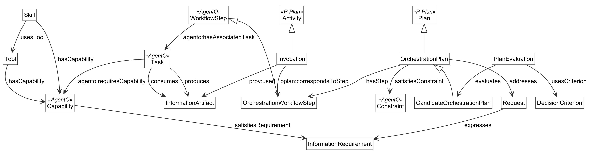

## Ontology-Guided Agentic Tool and Skill Orchestration

Team AgenticCapabilities: Gia Oriana Santos, Barbara Kotlan, Jiaying (Michael) Wang, Jialin (Gary) Fang and
Elioenai Lincon Guedes Alves.

## Abstract

LLM agents now reach many external tools and skills through the Model Context Protocol, but which of them to call, in
what order, and why is decided implicitly inside the model. This project puts an ontology between the user and the
agent harness. The ontology links a user's request, its information requirements and the user's constraints to the
capabilities that skills and tools provide; represents candidate orchestration plans with their steps, tasks and the
information artifacts each task consumes and produces; records how one plan is evaluated and selected; and traces each
invocation for provenance. A reasoner can then derive which tasks depend on each other, which skills a request needs, and
why one plan was chosen over another. The use case is scoped to personalized supplement recommendation with the PubMed,
Supplement Advisor and OpenFDA MCP servers and the iHerb command-line client, and the ontology reuses AgentO, P-Plan,
OWL-S, PROV-O, BEAM and the OMG Commons library.

## Overview Diagram

Each box is a class of the ontology and each arrow a property; the [Concept Map & Ontology](ontology.html) page has all
figures.

## List of Resources

<table>
  <tr>
    <th>Resources</th>
    <th>Links</th>
  </tr>
  <tr>
    <td>1. Ontology</td>
    <td><a href="agentic-orchestration.rdf">agentic-orchestration.rdf</a> (RDF/XML), described on the <a href="ontology.html">Concept Map &amp; Ontology</a> page</td>
  </tr>
  <tr>
    <td>2. Use Case</td>
    <td><a href="usecase.html">Use case document</a>, with the competency questions in Section VII</td>
  </tr>
  <tr>
    <td>3. Term List</td>
    <td><a href="termlist.html">Curated terminology list</a></td>
  </tr>
  <tr>
    <td>4. Competency Question Examples</td>
    <td><a href="files/ontology/cq_examples.ttl">Example individuals</a> and <a href="files/ontology/cq_results.txt">reasoner answers</a> for CQ 1, CQ 3 and CQ 5 (and CQ 2 and CQ 6)</td>
  </tr>
  <tr>
    <td>5. Presentations</td>
    <td><a href="presentations.html">Project presentations during class</a></td>
  </tr>
  <tr>
    <td>6. Reports</td>
    <td><a href="files/reports/OE_6_TeamAgenticCapabilities_Report.pdf">Assignment 6 report</a>: ontology development, what was difficult and what worked, controversial decisions, GenAI use</td>
  </tr>
</table>

## Acknowledgements

This project is part of Ontology Engineering (Fall 2026) at Rensselaer Polytechnic Institute. We thank the instructors
and the teaching assistant for their feedback on each version of our artifacts.
