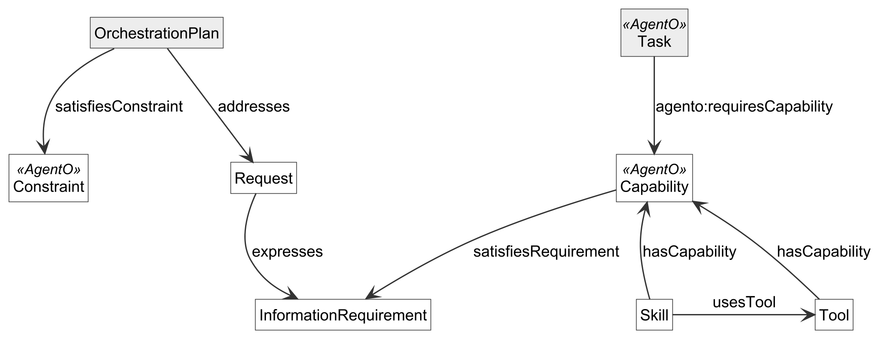
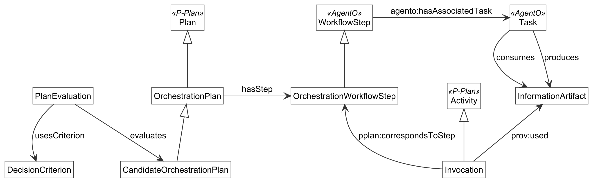

## Ontology-Guided Agentic Tool and Skill Orchestration

Team AgenticCapabilities: [Gia Oriana Santos](https://github.com/haimgia),
[Barbara Kotlan](https://github.com/barbarakotlan), [Jiaying (Michael) Wang](https://github.com/QuellaMC),
[Jialin (Gary) Fang](https://github.com/1jifang) and Elioenai Lincon Guedes Alves.

## Abstract

Large language model (LLM) agents now extend themselves in two ways: through tools, exposed by external servers like
Model Context Protocol (MCP) and command-line interfaces, and through skills, modular packages of instructions and
resources the agent loads to perform specialized tasks. As both multiply, agents must decide which tools and which skills
to invoke, in what order, under what dependencies, and against which user preferences, and they rarely explain those
choices. We present the Agentic Capabilities Ontology, an OWL 2 DL ontology that acts as a semantic layer between the
user and the agent harness. It treats tools and skills as parallel providers of capabilities, describing each one's
inputs, outputs, preconditions, dependencies and constraints, and recording tool invocations and skill invocations alike
as provenance. The ontology reuses AgentO, P-Plan, PROV-O and OWL-S, and models requests and their information
requirements, hard and soft user constraints, candidate orchestration plans composed of workflow steps, and plan
evaluations scored on decision criteria such as tool call count, token cost and evidence coverage. Defined classes and
property chains let a reasoner infer which tools and skills satisfy which requirements, how steps depend on one another
through the information artifacts they consume and produce, and which plan is selected. We evaluate the ontology on a
personalized supplement-recommendation use case with four skills and four external servers, answering nine competency
questions with SPARQL over the inferred knowledge graph, covering plan selection, required tools and skills, parallel
execution, constraint violations, prerequisite readiness, and explanations of why each was chosen.

## Overview Diagram

Each box is a class of the ontology and each arrow a property; the [Concept Map & Ontology](ontology.html) page has all
figures.

## List of Resources

<table>
  <tr>
    <th>Resources</th>
    <th>Links</th>
  </tr>
  <tr>
    <td>1. Ontology</td>
    <td><a href="OE_11_TeamAgenticCapabilities.rdf">OE_11_TeamAgenticCapabilities.rdf</a> and its <a href="OE_11_TeamAgenticCapabilities_Individuals.rdf">individuals</a> (RDF/XML), described on the <a href="ontology.html">Concept Map &amp; Ontology</a> page</td>
  </tr>
  <tr>
    <td>2. Use Case</td>
    <td><a href="usecase.html">Use case document</a>, with the competency questions in Section VII</td>
  </tr>
  <tr>
    <td>3. Term List</td>
    <td><a href="termlist.html">Curated terminology list</a></td>
  </tr>
  <tr>
    <td>4. Competency Question Queries</td>
    <td><a href="demo.html">SPARQL queries and answers</a> for all nine competency questions, and the <a href="OE_11_TeamAgenticCapabilities_Queries.txt">query file</a> to run in Protégé</td>
  </tr>
  <tr>
    <td>5. Presentations</td>
    <td><a href="presentations.html">Project presentations during class</a></td>
  </tr>
  <tr>
    <td>6. Reports</td>
    <td><a href="files/reports/OE_6_TeamAgenticCapabilities_Report.pdf">Assignment 6 report</a>: ontology development, what was difficult and what worked, controversial decisions, GenAI use</td>
  </tr>
</table>

## Acknowledgements

This project is part of Ontology Engineering (Fall 2026) at Rensselaer Polytechnic Institute. We thank the instructors
and the teaching assistant for their feedback on each version of our artifacts.
