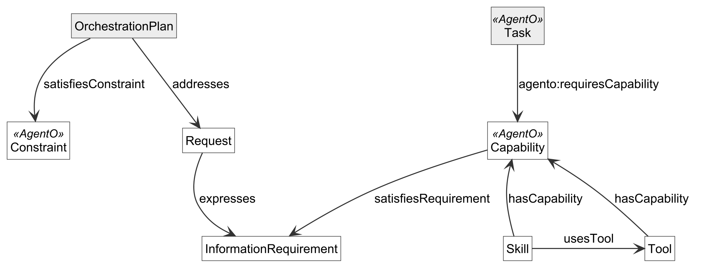
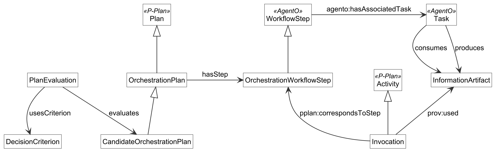
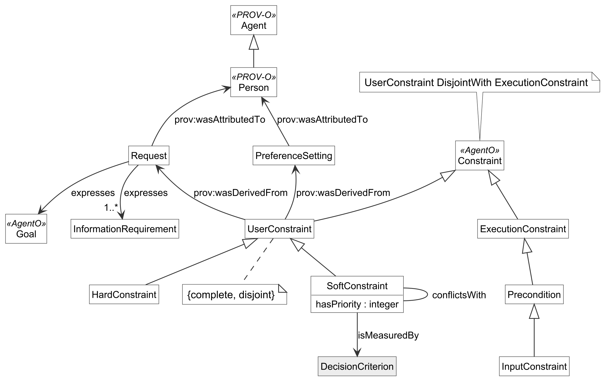
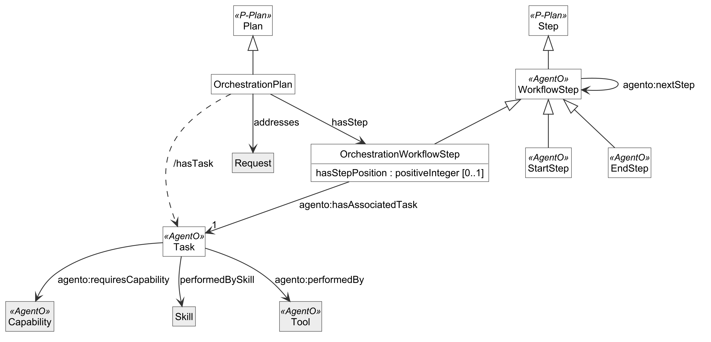
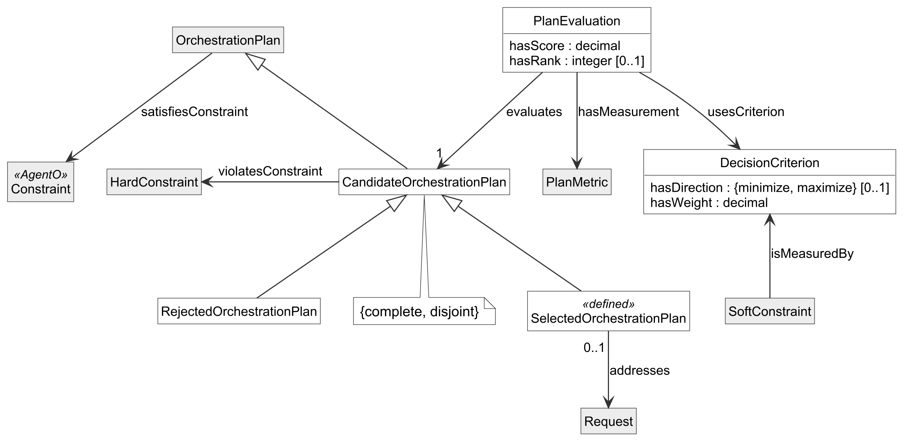

[Concept Map](#conceptual-model) | [Ontology File](#ontology) | [Ontologies Reused](#ontologies-reused) | [Ontology Prefixes](#ontology-prefixes)

## Conceptual Model

**Assignment 12 pairs conceptual model 5.0 with ontology 4.2.**
[Download the documented conceptual model (PDF)](files/conceptual_models/OE_12_TeamAgenticCapabilities_ConceptualModel.pdf).

An agent choosing among skills and tools needs to explain what each one contributes and which steps must finish
before others can start. In our supplement-recommendation use case, a request can call for evidence, safety screening
or products within a budget. The ontology connects those requirements to capabilities and records how candidate
plans meet them. The two overview figures follow a request from the user's requirements to the execution of a plan.

**Figure 1a** shows how skills and tools provide capabilities that satisfy information requirements. The same request
can therefore lead to different candidate plans, each subject to the user's constraints.

**Figure 1b** follows a candidate plan through evaluation and execution. Each workflow step has a task. The
invocation recorded when a step runs connects the plan to the information the agent used or produced.

**Figure 2** traces a constraint to the request or saved preference that supplied it. Jessica's safety-screening
requirement is a hard constraint. Ken's preference for fewer tool calls helps rank plans that already qualify.

**Figure 5a** shows how a plan orders its steps and assigns a task to each step. The step position lets the
third query for Ken's request return his selected plan in execution order.

**Figure 6a** connects each candidate plan to its evaluation, criteria, score and rank. It explains how the
reasoner can identify the selected plan and how the demonstration compares it with the alternatives.

<iframe title="Assignment 12 conceptual model, version 5.0" src="files/conceptual_models/OE_12_TeamAgenticCapabilities_ConceptualModel.pdf" style="width: 100%;height: 700px;border: none;"></iframe>

Model 5.0 adds documentation to the diagrams introduced in earlier releases. Each figure is available below,
along with the [PlantUML sources](files/conceptual_models/v5.0/src/).
[1a](files/conceptual_models/v3.0/fig1a_overview_requests.png) ·
[1b](files/conceptual_models/v3.0/fig1b_overview_plans.png) ·
[2](files/conceptual_models/v3.0/fig2_requests_constraints.png) ·
[3a](files/conceptual_models/v3.0/fig3a_skills_resources.png) ·
[3b](files/conceptual_models/v3.0/fig3b_capabilities.png) ·
[3c](files/conceptual_models/v3.0/fig3c_justified_capabilities.png) ·
[4](files/conceptual_models/v3.0/fig4_tools_servers.png) ·
[5a](files/conceptual_models/v5.0/fig5a_plan_structure.png) ·
[5b](files/conceptual_models/v3.0/fig5b_task_dependencies.png) ·
[5c](files/conceptual_models/v3.0/fig5c_inferred_dependencies.png) ·
[6a](files/conceptual_models/v3.0/fig6a_plan_selection.png) ·
[6b](files/conceptual_models/v3.0/fig6b_plan_metrics.png) ·
[7a](files/conceptual_models/v4.0/fig7a_invocations.png) ·
[7b](files/conceptual_models/v3.0/fig7b_artifact_provenance.png) ·
[8a](files/conceptual_models/v3.0/fig8a_artifact_kinds.png) ·
[8b](files/conceptual_models/v3.0/fig8b_artifact_roles.png) ·
[9a](files/conceptual_models/v4.0/fig9a_request_shortcuts.png) ·
[9b](files/conceptual_models/v4.0/fig9b_skill_tool_shortcuts.png) ·
[9c](files/conceptual_models/v4.0/fig9c_step_shortcuts.png) ·
[9d](files/conceptual_models/v4.0/fig9d_plan_shortcuts.png) ·
[9e](files/conceptual_models/v4.0/fig9e_plan_artifacts.png)

### Previous Versions

- Version 4.1 (Assignment 11) includes the [clean PDF](files/conceptual_models/OE_11_TeamAgenticCapabilities_ConceptMap_Clean.pdf)
  and [redlined PDF](files/conceptual_models/OE_11_TeamAgenticCapabilities_RedlinedConceptMap.pdf).
- Version 4.0 (Assignment 10): [clean](files/conceptual_models/OE_10_TeamAgenticCapabilities_ConceptMap_Clean.pdf) and
  [new parts in blue](files/conceptual_models/OE_10_TeamAgenticCapabilities_ConceptMap.pdf), figures and PlantUML
  sources in [files/conceptual_models/v4.0](files/conceptual_models/v4.0/src/)
- [Version 3.0 (Assignment 8, unchanged in Assignment 9)](files/conceptual_models/OE_8_TeamAgenticCapabilities_ConceptualModel.pdf),
  figures and PlantUML sources in [files/conceptual_models/v3.0](files/conceptual_models/v3.0/src/)
- [Version 2.0 (Assignment 6)](files/conceptual_models/OE_6_TeamAgenticCapabilities_ConceptualModel.pdf)
  ([redlined](files/conceptual_models/OE_6_TeamAgenticCapabilities_RedlinedConceptualModel.pdf)), figures and PlantUML
  sources in [files/conceptual_models/v2.0](files/conceptual_models/v2.0/src/)
- [Version 1.1 (Assignment 5)](files/conceptual_models/OE_5_TeamAgenticCapabilities_ConceptualModel.pdf)
- Protégé OntoGraf views of the Figure 4 and Figure 7 classes:
  [Figure 4](files/conceptual_models/Figure4-Tools-Servers.png),
  [Figure 7](files/conceptual_models/Figure7-Execution-Provenance.png),
  [combined](files/conceptual_models/Figures4-and-7-Combined.png)

## Ontology

**Assignment 12, version 4.2 (November 20, 2026).** The main OWL ontology defines 64 classes, 49 object
properties and 9 datatype properties belonging to the team. The accompanying ontology contains 171 individuals.
This release adds term-list annotations, clarifies property domains and ranges, and removes the FIBO import. Ken's
plan query now lists his steps without repeating the plan label in every row.

| Assignment | Version | Main ontology | Individuals | SPARQL queries |
|---|---|---|---|---|
| 12 (current) | `v4.2` | [RDF/XML](OE_12_TeamAgenticCapabilities.rdf) | [RDF/XML](OE_12_TeamAgenticCapabilities_Individuals.rdf) | [Query file](OE_12_TeamAgenticCapabilities_Queries.txt) |
| 11 | `v4.1` | [Archived ontology](archived/OE_11_TeamAgenticCapabilities.txt) | [Archived individuals](archived/OE_11_TeamAgenticCapabilities_Individuals.txt) | [Query file](archived/OE_11_TeamAgenticCapabilities_Queries.txt) |
| 10 | `v4.0` | [Archived ontology](archived/OE_10_TeamAgenticCapabilities.txt) | [Archived individuals](archived/OE_10_TeamAgenticCapabilities_Individuals.txt) | [Query file](archived/OE_10_TeamAgenticCapabilities_Queries.txt) |

**Version IRIs.** The current main ontology identifies itself as
`https://tw.rpi.edu/ontology-engineering/oe2026/agentic-orchestration/v4.2` and the individuals as
`https://tw.rpi.edu/ontology-engineering/oe2026/agentic-orchestration/agentic-orchestration-individuals/v4.2`.
Both headers identify the corresponding `v4.1` and `v4.0` IRIs as prior versions. The table links to the files for
each version. The [maintenance and evolution policy](gettinginvolved.html#maintenance-policy) describes how the team
versions and tests a release.

**Opening the ontology in Protégé.** Keep the two Assignment 12 RDF files and the [XML catalog](catalog-v001.xml)
together with the project's `imports/` folder. Open `OE_12_TeamAgenticCapabilities_Individuals.rdf`. The catalog
resolves its import of the main ontology's `v4.2` IRI and supplies local copies of AgentO and P-Plan.

**Validation.** The team ran Pellet and HermiT against the Assignment 12 ontologies. Both reasoners found them
consistent, all 11 queries returned their expected answers, the course hygiene check passed, and our 15 regression
tests pass ([test log](files/ontology/OE_12_TeamAgenticCapabilities_TestLog.txt)). The
[demonstration](demo.html) gives the queries and results for all nine competency questions in the [use case](usecase.html).

**Earlier releases.** The test logs of earlier releases are available for
[Assignment 11](files/ontology/OE_11_TeamAgenticCapabilities_TestLog.txt) and
[Assignment 10](files/ontology/OE_10_TeamAgenticCapabilities_TestLog.txt).

- Assignment 9 includes the [main ontology](archived/OE_9_TeamAgenticCapabilities.txt),
  [individuals](archived/OE_9_TeamAgenticCapabilities_Individuals.txt),
  [queries](archived/OE_9_TeamAgenticCapabilities_SPARQLQueries.txt) and
  [test log](files/ontology/OE_9_TeamAgenticCapabilities_TestLog.txt).
- Assignment 8 includes the [main ontology](archived/OE_8_TeamAgenticCapabilities.txt) and
  [individuals](archived/OE_8_TeamAgenticCapabilities_Individuals.txt).
- Assignment 6 includes the [main ontology](archived/agentic-orchestration.txt),
  [example individuals](archived/cq_examples.txt) and [reasoner answers](archived/cq_results.txt).

The archive stores earlier ontology files with a `.txt` extension so the hygiene check runs on the current RDF files.

### Main Classes and Definitions

| Class | Superclass | Definition |
|---|---|---|
| Request | — | user input that expresses a task, action, or information need for an agent to address |
| InformationRequirement | — | formalized description of information that a user needs to obtain |
| UserConstraint | agento:Constraint | constraint derived from a user's request, profile, or execution preferences that governs the selection or execution of an orchestration plan |
| Capability | equivalent to agento:Capability | ability of an agent to perform a type of action or task |
| Skill | — | specification of a focused agent behavior that can be applied to perform a class of tasks |
| Tool | agento:Tool, process:Process | callable computational resource that performs a defined operation when invoked |
| Server | — | software component that exposes computational resources and operations to clients through a communication protocol |
| OrchestrationPlan | pplan:Plan | plan that prescribes which capabilities to invoke, and in what order, to satisfy the information requirements of one request |
| OrchestrationWorkflowStep | agento:WorkflowStep | workflow step of an orchestration plan that is associated with the task carried out at that point in the plan |
| InformationArtifact | prov:Entity | information content entity represented as an identifiable item that can be consumed, produced, or retained during an agent workflow |
| PlanEvaluation | — | evaluation record that associates an orchestration plan with the criteria used and the plan metrics obtained |
| DecisionCriterion | — | criterion used to compare and select candidate orchestration plans based on measurable attributes and preferences |
| PlanMetric | cmns-qtu:Measure | measure used in an evaluation to characterize an orchestration plan on a specified dimension |
| Invocation | pplan:Activity | execution activity in which a particular tool or skill is called or applied |
| EvidenceAssessment | Assessment | assessment that summarizes and weighs the research findings about one candidate supplement |

The full list of classes, properties and individuals, with sources, is the [terminology list](termlist.html).

## Ontologies Reused

- [AgentO v0.2](imports/agento-v0.2.owl) supplies the vocabulary for agents, tasks, tools, capabilities and workflow steps.
- [P-Plan 1.3](imports/p-plan-1.3.ttl) describes plans, steps and the activities that carry them out.
- [OWL-S 1.2](https://www.w3.org/submissions/OWL-S/) describes tool parameters and preconditions.
- [PROV-O](https://www.w3.org/TR/prov-o/) records the provenance of invocations and information artifacts.
- The [OMG Commons Ontology Library](https://www.omg.org/spec/Commons/) supplies the imported annotation vocabulary.
  The ontology also reuses the Commons `Measure` class for plan metrics and [BEAM](https://w3id.org/beam/core)'s
  `Resource` class for skill resources.

## Ontology Prefixes

| Prefix | Namespace |
|---|---|
| oe-agtorch | `https://tw.rpi.edu/ontology-engineering/oe2026/agentic-orchestration/` |
| oe-agtorch-ind | `https://tw.rpi.edu/ontology-engineering/oe2026/agentic-orchestration/agentic-orchestration-individuals/` |
| agento | `http://www.w3id.org/agentic-ai/onto#` |
| pplan | `http://purl.org/net/p-plan#` |
| process | `http://www.daml.org/services/owl-s/1.2/Process.owl#` |
| prov | `http://www.w3.org/ns/prov#` |
| cmns-av | `https://www.omg.org/spec/Commons/AnnotationVocabulary/` |
| cmns-qtu | `https://www.omg.org/spec/Commons/QuantitiesAndUnits/` |
| beam | `http://w3id.org/beam/core#` |
| dct | `http://purl.org/dc/terms/` |
| skos | `http://www.w3.org/2004/02/skos/core#` |
| owl | `http://www.w3.org/2002/07/owl#` |
| rdfs | `http://www.w3.org/2000/01/rdf-schema#` |
| xsd | `http://www.w3.org/2001/XMLSchema#` |
