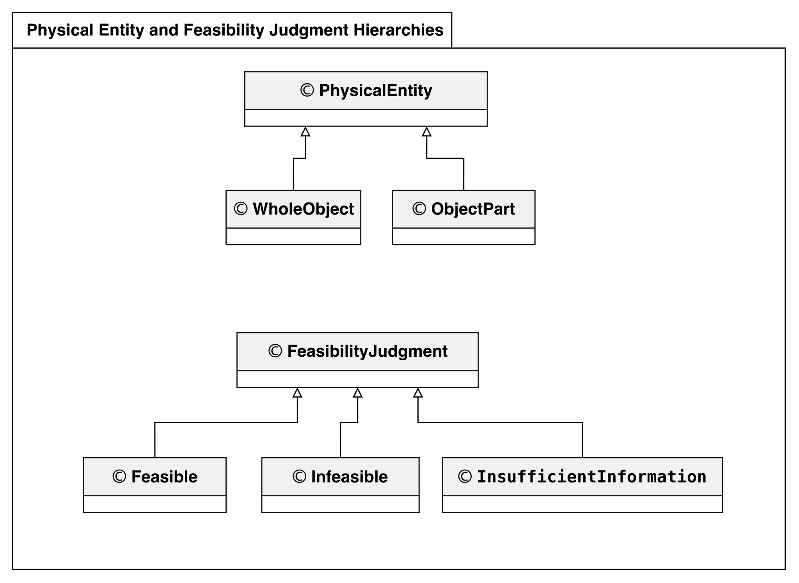
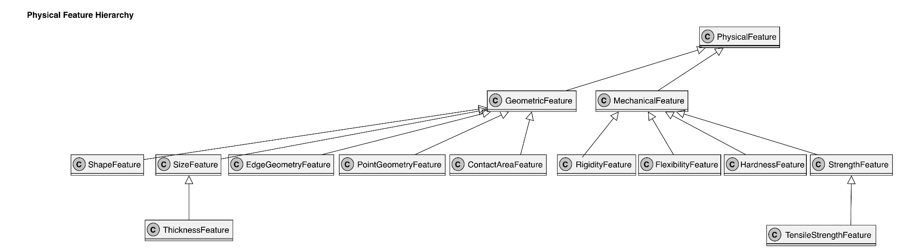
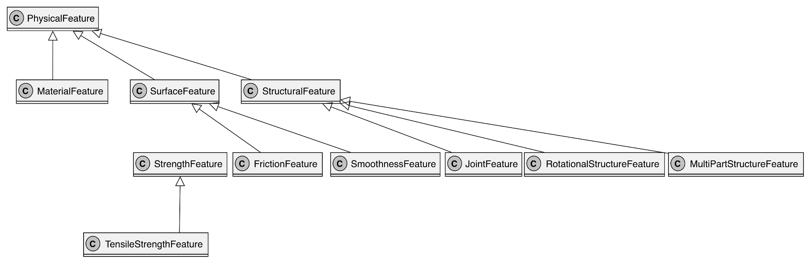
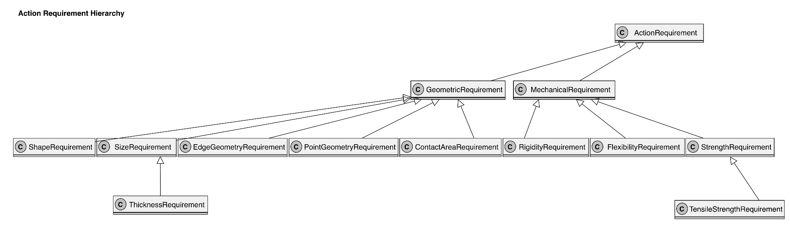
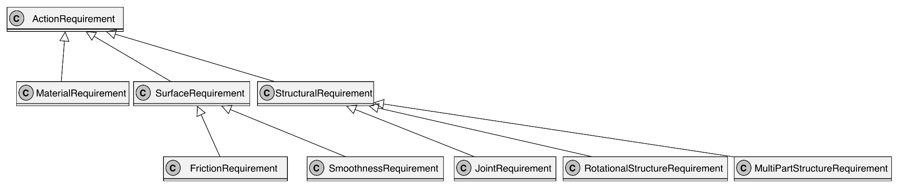
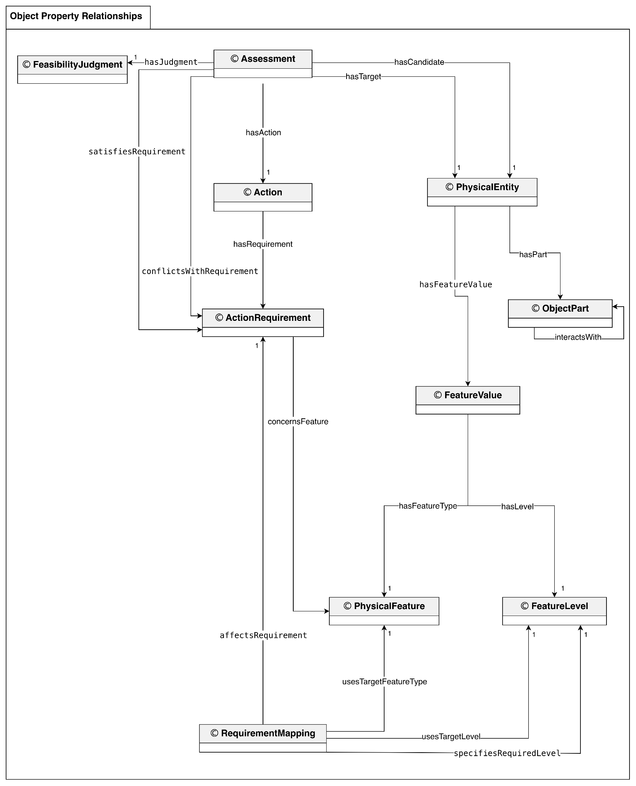

[Conceptual model](#conceptual-model) · [Ontology versions](#ontologies)

## Conceptual Model

The current conceptual model comes from the Assignment 8 document, last modified on October 23, 2026. It replaces the preliminary Assignment 5 model with `PhysicalFeature`, `FeatureValue`, `FeatureLevel`, `Assessment`, and `RequirementMapping`. The hierarchy panels show classification; open triangular arrowheads point toward the superclass. The relationship diagram shows object properties directed from domain to range. Click any diagram to open the full-size image.

[Download the current conceptual model document](files/OE_8_TeamAffordance_ConceptualModel.docx) · [View its Google Drive source](https://docs.google.com/document/d/1Kkpk0DTprUycWd9IoTgjS5E9wsCXP51V/edit)

<figure>
  
  <figcaption><strong>Diagram 1a. Physical entities and feasibility judgments.</strong></figcaption>
</figure>

`PhysicalEntity` distinguishes whole objects from object parts. `FeasibilityJudgment` groups the feasible, infeasible, and insufficient-information outcomes used to describe an assessment.

<figure>
  
  <figcaption><strong>Diagram 1b. Geometric and mechanical physical features.</strong></figcaption>
</figure>

This panel organizes geometric features such as shape, size, edge geometry, point geometry, and contact area, together with mechanical features such as rigidity, flexibility, hardness, and strength. These classes supply vocabulary for the physical descriptions evaluated against CUT requirements.

<figure>
  
  <figcaption><strong>Diagram 1c. Material, surface, and structural physical features.</strong></figcaption>
</figure>

This continuation of the feature hierarchy includes friction, smoothness, joint, rotational-structure, and multipart-structure features. Repeated superclass labels connect this panel to the preceding feature hierarchy; they do not represent separate models.

<figure>
  
  <figcaption><strong>Diagram 1d. Geometric and mechanical action requirements.</strong></figcaption>
</figure>

The requirement hierarchy parallels the feature vocabulary, including geometry, contact area, rigidity, flexibility, and strength requirements. It describes the kinds of physical conditions against which a candidate's represented evidence can be assessed.

<figure>
  
  <figcaption><strong>Diagram 1e. Material, surface, and structural action requirements.</strong></figcaption>
</figure>

This panel continues the requirement hierarchy with material, friction, smoothness, joint, rotational-structure, and multipart-structure requirements. Together, the requirement panels provide vocabulary for comparing different physical realizations of CUT.

<figure>
  
  <figcaption><strong>Diagram 2. Object-property relationships for CUT assessment.</strong></figcaption>
</figure>

An `Assessment` connects a candidate, target, action, and judgment. A `PhysicalEntity` has `FeatureValue` instances, each connecting a `PhysicalFeature` to a categorical `FeatureLevel`. Actions link to requirements, and `RequirementMapping` connects target conditions to required feature levels. `hasPart` and `interactsWith` represent part structure and interactions. This structure supports individual assessments, candidate comparisons, and comparisons involving interacting parts such as scissor blades. Multiplicity 1 denotes exactly one related instance of the indicated class in the source model.

### Earlier Conceptual Model

- [Assignment 5 conceptual model](files/OE_5_TeamAffordance_ConceptualModel.docx)

## Ontologies

Versions are listed with the most recent team ontology first. The Assignment 8 files were retrieved from Google Drive on October 25, 2026; their original ontology contents are preserved.

| Version | Files |
| --- | --- |
| **Assignment 8 — repository release** | [Ontology RDF](files/OE_8_TeamAffordance.rdf) · [CQ individuals RDF](files/OE_8_TeamAffordance_Individuals.rdf) |
| Assignment 8 — full team merge from Google Drive | [Download RDF](files/OE_8_TeamAffordance_HP_XF_Alex_LZ_merged_full.rdf) · [Google Drive source](https://drive.google.com/file/d/1A-YQYQOtGq6J_Y9icRkcCUrtyH1LkfKi/view) |
| Assignment 6 | [Download RDF](files/OE_6_TeamAffordance.rdf) |
| Preliminary repository ontology | [Download RDF](physical-properties.rdf) |

### Assignment 8 Individuals

[Download the individuals ontology contributed by Liangliang Zhang](files/OE_8_TeamAffordance_Individuals_LiangliangZhang.rdf) · [Google Drive source](https://drive.google.com/file/d/1ji1mAx1tn-IUDPdaAC4gw_Z-Xs1-SSYC/view)

This is the separately supplied individuals file; its contributor label is retained rather than implying that it is a combined team individuals ontology.

### Intermediate Assignment 8 Merges

These earlier working merges are retained as provenance links, in reverse order of modification. Use the repository release above for the current ontology.

- [HP, XF, and Alex merged draft](https://drive.google.com/file/d/1MyImpmcCujejinNQmc5TM6NwvB6bEOdV/view)
- [HP and XF merged draft](https://drive.google.com/file/d/1se9iysw335EH3p3V0wk25zhUi1kF2zDR/view)
