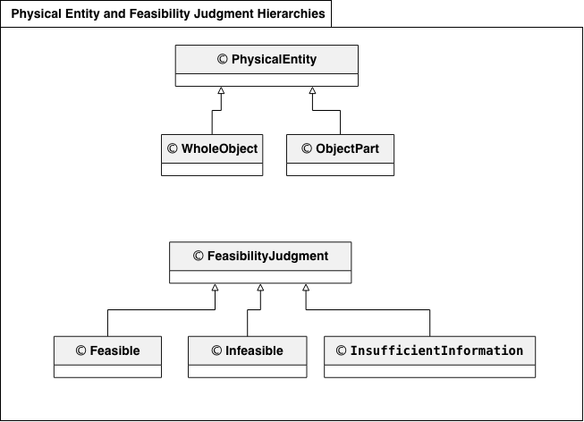
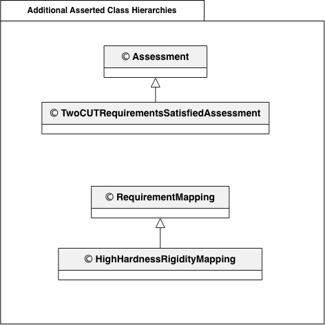
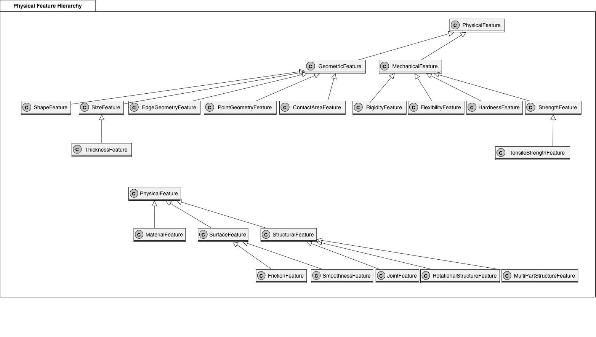
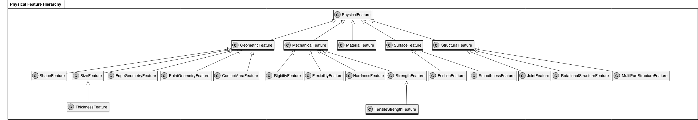
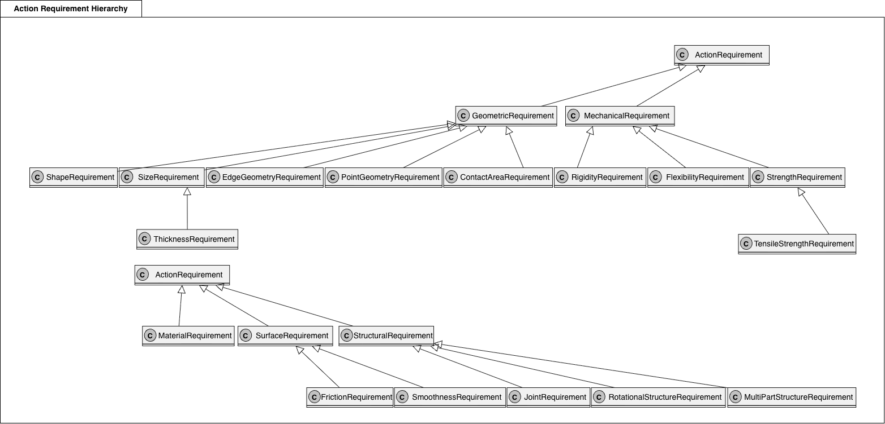
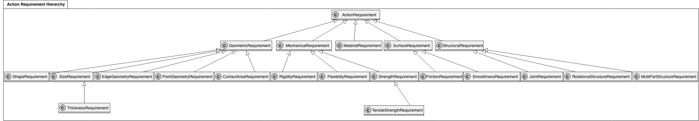
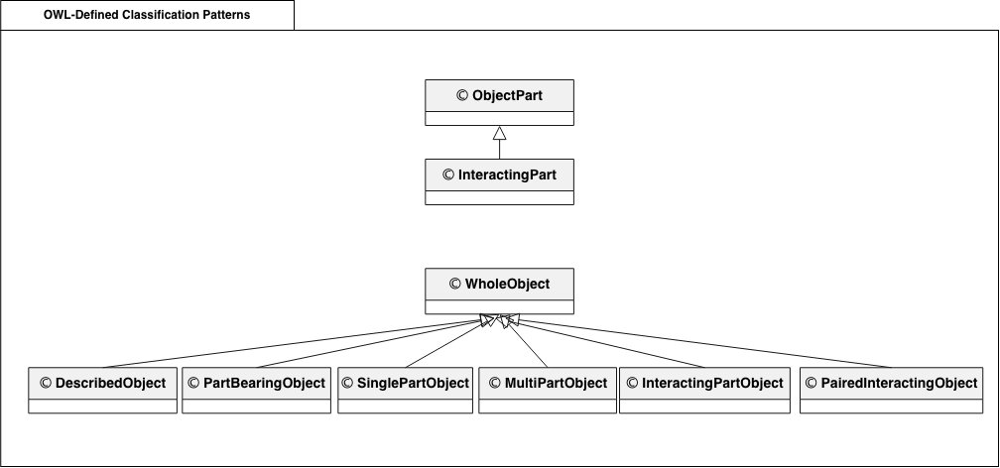
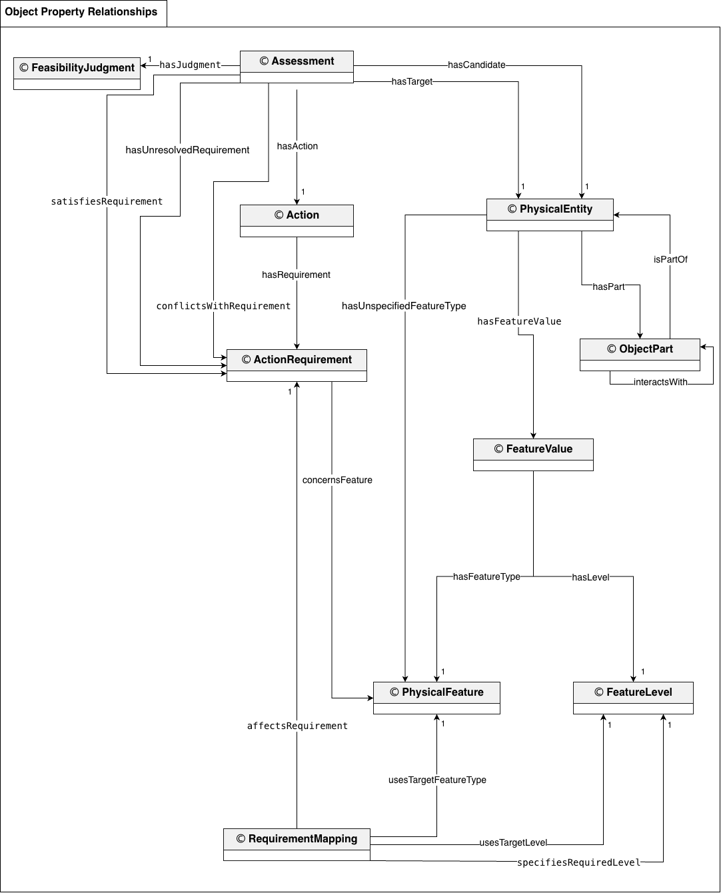

[Conceptual model](#conceptual-model) · [Ontology versions](#ontologies)

## Conceptual Model

The current conceptual model comes from the Assignment 11 document.

<iframe src="files/OE_11_TeamAffordance_ConceptualModel.pdf" style="width: 100%;height: 700px;border: none;"></iframe>

### Asserted Class Hierarchies
The ontology organizes its main concepts into several class hierarchies, separating physical entities, physical features, action requirements, and feasibility judgments. **PhysicalEntity** distinguishes complete objects and their constituent parts through **WholeObject** and **ObjectPart**. **PhysicalFeature** organizes the characteristics used to describe candidates and targets, including geometric, mechanical, material, surface, and structural features. The corresponding **ActionRequirement** hierarchy represents the physical characteristics relevant to determining whether CUT requirements can be met. Although **PhysicalFeature** and **ActionRequirement** contain related categories, they serve different purposes. **PhysicalFeature** describes what is represented about an entity, whereas **ActionRequirement** describes what is needed for an action. Keeping these concepts separate allows candidate and target characteristics to be evaluated against action-specific requirements. The **FeasibilityJudgment** hierarchy distinguishes **Feasible**, **Infeasible**, and **InsufficientInformation** outcomes. Additional asserted subclass relationships include **TwoCUTRequirementsSatisfiedAssessment**, a specialization of **Assessment**, and **HighHardnessRigidityMapping**, a specialization of **RequirementMapping**. These classes support the representation and evaluation of specific conditions within the CUT model.

<figure>
  
  <figcaption><strong>Figure 1. Physical Entity and Feasibility Judgment Hierarchies.</strong></figcaption>
</figure>

<figure>
  
  <figcaption><strong>Figure 2. Additional Asserted Class Hierarchies.</strong></figcaption>
</figure>

<figure>
  
  <figcaption><strong>Figure 3. Physical Feature Hierarchy.</strong></figcaption>
</figure>
<figure>
  
  <figcaption><strong>Alternative Figure 3. Physical Feature Hierarchy.</strong></figcaption>
</figure>

<figure>
  
  <figcaption><strong>Figure 4. Action Requirement Heerarchy..</strong></figcaption>
</figure>
<figure>
  
  <figcaption><strong>Alternative Figure 4. Action Requirement Heerarchy..</strong></figcaption>
</figure>

### WOL-Defined Classification Pattern

The ontology organizes its main concepts into several class hierarchies, separating physical entities, physical features, action requirements, and feasibility judgments. **PhysicalEntity** distinguishes complete objects and their constituent parts through **WholeObject** and **ObjectPart**. **PhysicalFeature** organizes the characteristics used to describe candidates and targets, including geometric, mechanical, material, surface, and structural features. The corresponding **ActionRequirement** hierarchy represents the physical characteristics relevant to determining whether CUT requirements can be met. Although **PhysicalFeature** and **ActionRequirement** contain related categories, they serve different purposes. **PhysicalFeature** describes what is represented about an entity, whereas **ActionRequirement** describes what is needed for an action. Keeping these concepts separate allows candidate and target characteristics to be evaluated against action-specific requirements. The **FeasibilityJudgment** hierarchy distinguishes **Feasible**, **Infeasible**, and **InsufficientInformation** outcomes. Additional asserted subclass relationships include **TwoCUTRequirementsSatisfiedAssessment**, a specialization of **Assessment**, and **HighHardnessRigidityMapping**, a specialization of **RequirementMapping**. These classes support the representation and evaluation of specific conditions within the CUT model.

<figure>
  
  <figcaption><strong>Figure 5. Selected OWL-Defined Classification Patterns.</strong></figcaption>
</figure>

### Property-Grounded CUT Assessment Model

The central assessment model connects an **Assessment** to its candidate, target, action, and feasibility judgment through the properties *hasCandidate*, *hasTarget*, *hasAction*, and *hasJudgment*. Candidate and target are modeled as **PhysicalEntity** instances, with their roles determined by their relationships to the assessment rather than by separate object categories. Physical characteristics are represented using **FeatureValue**, which connects a **PhysicalFeature** to a categorical **FeatureLevel**. This structure allows an entity to carry explicit information about its physical characteristics without deriving those characteristics from its name or conventional function. An **Action** is linked to its **ActionRequirement** instances through *hasRequirement*, and each requirement identifies the relevant feature through *concernsFeature*. **RequirementMapping** connects target feature conditions to the levels required for the corresponding action requirement. This allows CUT evaluation to account for both candidate characteristics and relevant target conditions. The model also uses *hasUnspecifiedFeatureType* to explicitly represent a feature type for which a value has not been supplied. This is important for distinguishing insufficient information from an explicitly conflicting feature value. Missing assertions alone are not treated as evidence of infeasibility. In OE11, hasUnresolvedRequirement was added to connect an Assessment to an ActionRequirement whose status remains unresolved because the relevant feature information is explicitly marked as unspecified. This property has Assessment as its domain and ActionRequirement as its range. It is also declared disjoint with satisfiesRequirement and conflictsWithRequirement, allowing the three requirement-evaluation relationships to be represented separately.

<figure>
  
  <figcaption><strong>Figure 6. Object-Property Relationships Supporting Property-Grounded CUT Assessment.</strong></figcaption>
</figure>

Some CUT configurations depend not only on whole-object characteristics but also on the physical features and relationships of their constituent parts. As shown in Figure 6, the ontology represents part–whole relationships through *hasPart* and *isPartOf*, and interactions between object parts through *interactsWith*. Because **ObjectPart** is a subclass of **PhysicalEntity**, individual parts can also have their own **FeatureValue** descriptions. These relationships support the representation and evaluation of alternative CUT configurations, including knife and scissors assessments, without using conventional object functions as reasoning evidence. The OWL-defined classes shown in Figure 5 further support structural classification based on explicitly represented part relationships.

### Earlier Conceptual Model
- [Assignment 10 conceptual model](files/OE_10_TeamAffordance_ConceptualModel.pdf)
- [Assignment 9 conceptual model](files/OE_9_TeamAffordance_ConceptualModel.pdf)
- [Assignment 8 conceptual model](files/OE_8_TeamAffordance_ConceptualModel.pdf)
- [Assignment 5 conceptual model](files/OE_5_TeamAffordance_ConceptualModel.pdf)

## Ontologies

Versions are listed with the most recent team ontology first. The Assignment 9 files were retrieved from Google Drive on October 30, 2026; their original ontology contents are preserved.

| Version | Files |
| --- | --- |
| **Assignment 11 — latest release** | [Ontology RDF](files/OE_11_TeamAffordance.rdf) · [CQ individuals RDF](files/OE_11_TeamAffordance_Individuals.rdf) |

| Assignment 10 | [Ontology RDF](files/OE_10_TeamAffordance.rdf) · [CQ individuals RDF](files/OE_10_TeamAffordance_Individuals.rdf) |

| Assignment 9 | [Ontology RDF](files/OE_9_TeamAffordance.rdf) · [CQ individuals RDF](files/OE_9_TeamAffordance_Individuals.rdf) |

| Assignment 8 — ready to use verison | [Ontology RDF](files/OE_8_TeamAffordance.rdf) · [CQ individuals RDF](files/OE_8_TeamAffordance_Individuals.rdf) |

| Assignment 8 — full team merge from Google Drive | [Download RDF](files/OE_8_TeamAffordance_HP_XF_Alex_LZ_merged_full.rdf) · [Google Drive source](https://drive.google.com/file/d/1A-YQYQOtGq6J_Y9icRkcCUrtyH1LkfKi/view) |

| Assignment 6 | [Download RDF](files/OE_6_TeamAffordance.rdf) |

| Preliminary repository ontology | [Download RDF](physical-properties.rdf) |

### Assignment 8 Individuals

[Download the individuals ontology contributed by Liangliang Zhang](files/OE_8_TeamAffordance_Individuals_LiangliangZhang.rdf) · [Google Drive source](https://drive.google.com/file/d/1ji1mAx1tn-IUDPdaAC4gw_Z-Xs1-SSYC/view)

This is the separately supplied individuals file; its contributor label is retained rather than implying that it is a combined team individuals ontology.

### Intermediate Assignment 8 Merges

These earlier working merges are retained as provenance links, in reverse order of modification. Use the repository release above for the current ontology.

- [HP, XF, and Alex merged draft](https://drive.google.com/file/d/1MyImpmcCujejinNQmc5TM6NwvB6bEOdV/view)
- [HP and XF merged draft](https://drive.google.com/file/d/1se9iysw335EH3p3V0wk25zhUi1kF2zDR/view)
