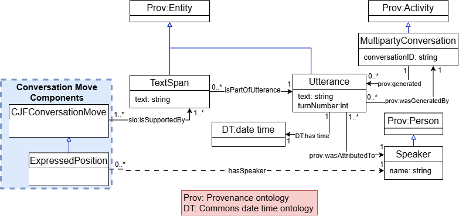

## Tracking Collective Judgment Formation in Multiparty Dialogue

How does a group develop a judgment over the course of a conversation? Our ontology represents the contributions that shape that process: information requests, issues, options, claims, expressed positions, and outcomes. It connects these conversation moves to one another, to their speakers, and to the transcript passages that provide evidence for them.

For conversation moves with states, the model records each state assignment, its effective utterance, its supporting evidence, and the preceding assignment. This history lets a researcher ask what has been discussed, which issues remain open, what supports or challenges an option, and how participants' positions develop. The project represents the group's reasoning and its provenance; it does not decide whether the group's judgment is correct.

## Team

This project is part of the Ontology Engineering course at Rensselaer Polytechnic Institute, Fall 2026.

| Team member | GitHub profile | Contact |
| --- | --- | --- |
| Devin De Silva | [DevinDeSilva](https://github.com/DevinDeSilva) | [desild@rpi.edu](mailto:desild@rpi.edu) |
| Tiziana Hernandez | [thernandez7](https://github.com/thernandez7) | [hernat@rpi.edu](mailto:hernat@rpi.edu) |
| Matthew Lausev | [mlau-hue](https://github.com/mlau-hue) | [lausem@rpi.edu](mailto:lausem@rpi.edu) |
| Srihari Sridharan | [sridhs3](https://github.com/sridhs3) | [sridhs3@rpi.edu](mailto:sridhs3@rpi.edu) |

## Project Model

<figure>
  
  <figcaption>Figure 1. Provenance of conversation moves in the OE Week 8 conceptual model.</figcaption>
</figure>

A conversation move is grounded in a text span within an utterance. The utterance preserves its position in the conversation and its speaker attribution. These links allow retrieved reasoning and state information to be accompanied by the original conversational evidence. The [conceptual model page](ontology.html#conceptual-model) displays the complete set of diagrams with descriptions.

## Current Resources

| Resource | Contents |
| --- | --- |
| [Use case](usecase.html) | Current OE Week 8 use case, scope, competency questions, and earlier documents |
| [Terminology list](termlist.html) | Current OE Week 8 curated term list and previous versions |
| [Conceptual model and ontology](ontology.html) | Current diagrams, schema, example individuals, reused vocabularies, and ontology versions |
| [Ontology version history](ontology-versions.html) | Committed schema snapshots, newest first |
| [Demonstration and queries](demo.html) | CQ1 query and recorded answers for the sample conversation |
| [Getting involved](gettinginvolved.html) | Project contacts and contribution information |
