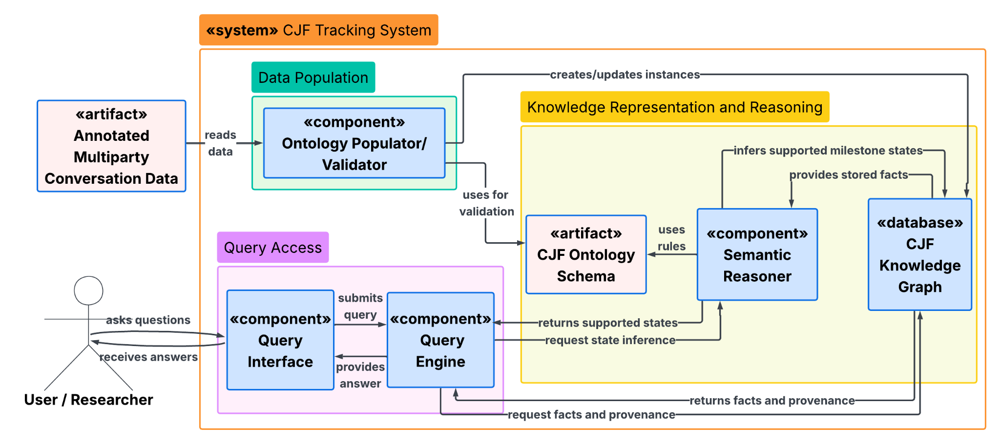
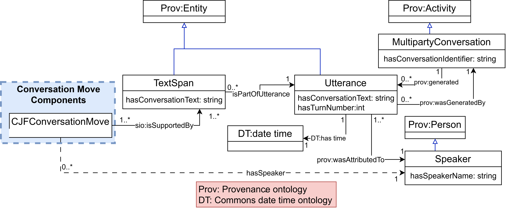
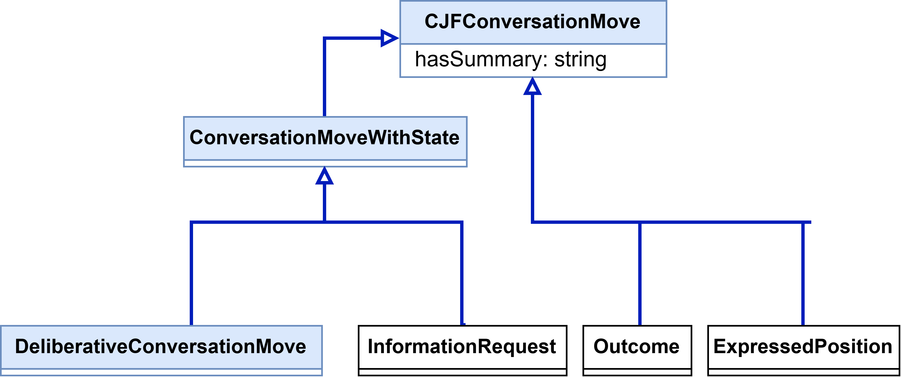
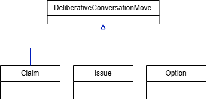
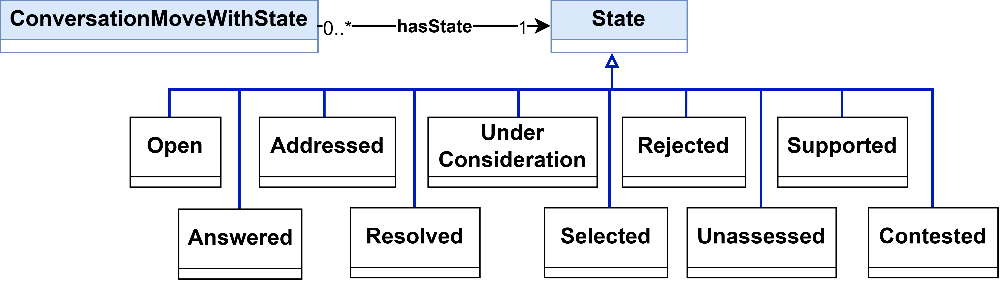
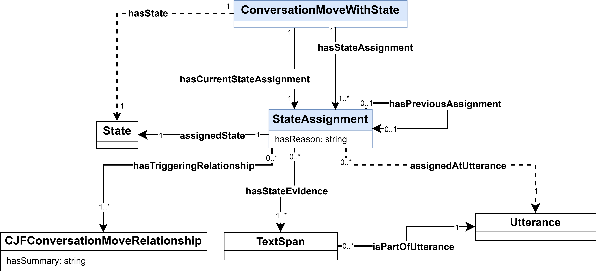
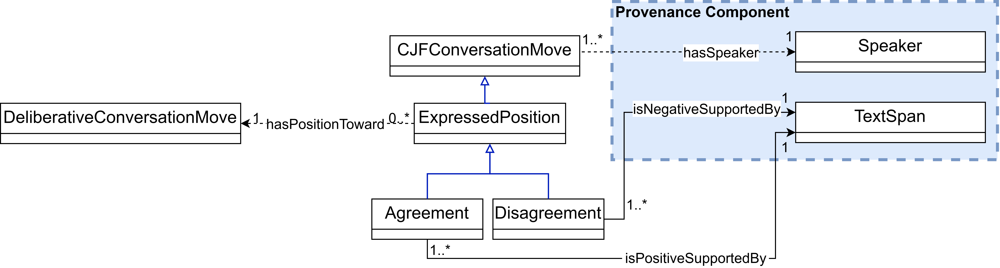
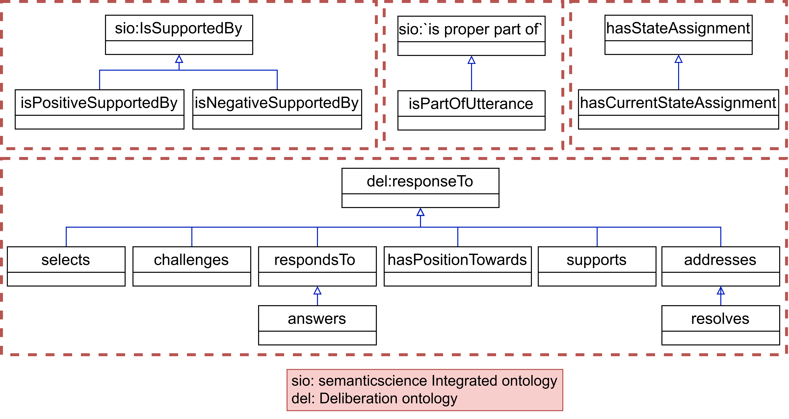
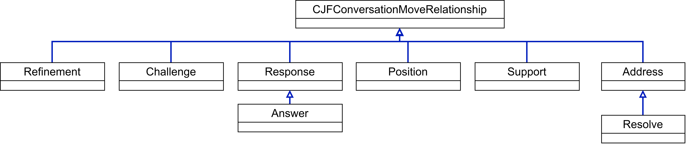
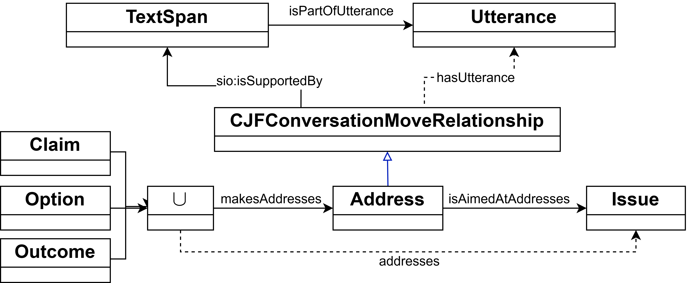

[Ontologies](#ontologies) | [Validation](#validation) | [Prior Versions](#prior-versions) | [Conceptual Model](#conceptual-model) | [Ontologies Reused](#ontologies-reused) | [Ontology Prefixes](#ontology-prefixes)

## Ontologies

### Tracking CJF Ontology 1.0

The Tracking Collective Judgment Formation ontology represents conversation moves, their relationships, transcript evidence, provenance, and state assignment histories. Its namespace is `https://tw.rpi.edu/ontology-engineering/oe2026/tracking-cjf/` (prefix `cjf`), and its version IRI is `https://tw.rpi.edu/ontology-engineering/oe2026/tracking-cjf/1.0/`. See the [use case](usecase.html) for the intended questions and the [term list](termlist.html) for terminology and sources.

| File | Purpose |
| --- | --- |
| [TeamCJF.rdf](ontology/TeamCJF.rdf) | The ontology schema: classes, properties, axioms, and term definitions |
| [TeamCJF_Individuals.rdf](ontology/TeamCJF_Individuals.rdf) | The sample conversation individuals with current-state-assignment links added by SHACL; use this file for the competency queries |
| [TeamCJF_IndividualsWithoutCurrentState.rdf](ontology/TeamCJF_IndividualsWithoutCurrentState.rdf) | The same individuals as generated from the annotations, before the SHACL step |
| [Ontology import catalog](ontology/catalog-v001.xml) | Local mappings that resolve the imports when the files sit in the same folder |
| [Filtered PROV-O copy](prev-ontology-versions/prov-o-cjf-filtered.owl) | Local copy of the PROV-O terms the project uses; the catalog loads it in place of the online PROV-O |
| [Current state assignment SHACL rules](shacl/current-state-assignment-rules.ttl) | Rules and constraints for identifying the latest recorded assignment for each move with state |

**Loading in Protégé.** Both files open directly in Protégé, either from a downloaded copy or with *File → Open from URL* using the file's address on this site. `TeamCJF.rdf` loads PROV-O and the OMG Commons Annotation Vocabulary from their published IRIs. `TeamCJF_Individuals.rdf` imports the schema from its published address on this site, so opening it also loads `TeamCJF.rdf` and its imports. To work offline, save the files together with `catalog-v001.xml`; the catalog resolves every import to the local copies.

Version 1.0 is released under the [MIT License](license.html). Its header records the creators, license, modification date, version IRI, and its prior version, OE_13. See the [maintenance policy](gettinginvolved.html#maintenance-policy) for versioning, compatibility, and community feedback, or [contact the team](gettinginvolved.html).

### Validation

We validated version 1.0 on November 27, 2026:

- **Reasoning:** HermiT 1.4.3 (the reasoner bundled with Protégé 5.6.9) finds the schema and sample individuals, with their imports, consistent and reports no unsatisfiable classes. It classifies the same individuals as in OE_13, for example 9 Agreements and 2 Resolved states.
- **Loading:** with the OWL API used by Protégé 5.6.9 and no catalog, `TeamCJF.rdf` loads from its address on this site, and a standalone copy of `TeamCJF_Individuals.rdf` loads together with all ten ontologies in its imports closure. HermiT finds the result consistent.
- **Regression against OE_13:** apart from the ontology header (version IRI, prior version, version information, modification date, change note, and, in the individuals, the address the schema is imported from), the 1.0 files contain the same triples as the OE_13 release.
- **Current state assignments:** rerunning the [SHACL rules](shacl/current-state-assignment-rules.ttl) on `TeamCJF_IndividualsWithoutCurrentState.rdf` conforms, adds 54 current-assignment links, and reproduces `TeamCJF_Individuals.rdf` exactly.
- **Competency questions:** in Protégé with HermiT, the six [demonstration queries](demo.html) returned 70, 32, 9, 11, 4, and 2 rows on OE_13, matching the recorded answer files. Version 1.0 has the same axioms and individuals, so the recorded answers apply to it unchanged.
- **Pipeline tests:** the 42 serializer tests pass, including the class and property naming checks on the 1.0 files.

## Prior Versions

Earlier releases (OE Weeks 8–13) keep their original IRIs and are available as downloadable `.rdf` files on the [Ontology Version History](ontology-versions.html#downloadable-versions) page. The most recent prior version is OE_13.

## Conceptual Model

### Problem and Ontology Overview

Multiparty conversations make it difficult to trace how a group develops a judgment and what evidence supports it. The Collective Judgment Formation (CJF) ontology models information requests, issues, options, claims, expressed positions, and outcomes, connecting them to speakers and transcript evidence. It also records state histories so researchers can examine open issues, supporting or challenging contributions, and changing positions throughout the conversation.

The gallery shows the latest project diagrams. Open an image to view it at full size, or download the editable file and open it in [diagrams.net](https://app.diagrams.net/). The [RDF schema](ontology/TeamCJF.rdf) gives the implemented identifiers and axioms.

<a href="files/conceptual-models/TeamCJF_ConceptualModel.drawio" download>Download the editable diagrams (.drawio)</a>

### Overview Diagram

<figure>
  
  <figcaption>Figure 1. High-level component overview of the CJF Tracking System.</figcaption>
</figure>

The diagram shows the CJF Tracking System’s main components. Annotated conversation data populates the knowledge graph and is validated against the ontology schema. The semantic reasoner uses stored facts and schema rules to infer supported states. Through the query interface and engine, researchers retrieve facts, provenance, and state information to trace how the group’s judgment develops.

### Provenance

<figure>
  
  <figcaption>Figure 2. Transcript evidence and speaker provenance for conversation moves.</figcaption>
</figure>

Each conversation move is supported by a TextSpan, and each TextSpan is part of an Utterance. The utterance records its text, turn number, and time. It is generated by a MultipartyConversation and attributed to a Speaker. A property chain over these links infers `hasSpeaker`, which CQ5 and CQ6 use to identify who expressed a position. Those questions also return the supporting TextSpan and its turn number as evidence.

### Conversation Moves with States

<figure>
  
  <figcaption>Figure 3. Conversation move taxonomy and the branch for moves with states.</figcaption>
</figure>

ConversationMoveWithState groups DeliberativeConversationMove and InformationRequest, the moves whose states change during a conversation. Outcome and ExpressedPosition sit directly under the general conversation move class because they have no states. This distinction supports CQ1, which lists every move and reports a state only where one applies. The next figure shows the three types of deliberative moves.

### Deliberative Conversation Moves

<figure>
  
  <figcaption>Figure 4. Claim, Issue, and Option as deliberative conversation moves.</figcaption>
</figure>

DeliberativeConversationMove has three subclasses: Claim, Issue, and Option. Each is also a ConversationMoveWithState, so CQ1 reports state information for all three.

### State Taxonomy

<figure>
  
  <figcaption>Figure 5. State taxonomy and the states that apply to each move type.</figcaption>
</figure>

Each ConversationMoveWithState is linked to its State through `hasState`. Each move with states has one current State, and any number of moves can share a State. These states support CQ1 and the question about Addressed and Resolved Issues in CQ2.

### State Assignment History

<figure>
  
  <figcaption>Figure 6. Current and historical state assignments with evidence and triggering relationships.</figcaption>
</figure>

Moves with states keep their state history as the current State changes. A move has one or more StateAssignment records through `hasStateAssignment`; its subproperty `hasCurrentStateAssignment` identifies the current one. Each StateAssignment records the State it assigns, the Utterance at which it applies, its supporting TextSpan, and a reason. `hasPreviousAssignment` links an assignment to the preceding one for the same move, so state changes can be traced through the conversation. `hasTriggeringRelationship` records the relationship that triggered a rule-based transition. The reasoner derives `hasState` from the current assignment's `assignedState`.

### Expressed Positions

<figure>
  
  <figcaption>Figure 7. Expressed positions, polarity evidence, and speaker attribution.</figcaption>
</figure>

Agreement and Disagreement specialize ExpressedPosition, which is itself a conversation move. The reasoner infers the subclass from the supporting evidence: `isPositiveSupportedBy` indicates Agreement, and `isNegativeSupportedBy` indicates Disagreement. `hasPositionTowards` links the position to its target move, and `hasSpeaker` links it to the Speaker. Together with turn information, these links support CQ5 and CQ6.

### Relationships between Conversation Moves

<figure>
  
  <figcaption>Figure 8. Semantic relationships among the conversation move types.</figcaption>
</figure>

The model connects claims, issues, options, outcomes, positions, and information requests through relationships such as supports, challenges, answers, addresses, resolves, and selects. Competing options are linked by the symmetric `isAlternativeTo` property, and information requests point to what they ask about through `isAbout`. These links let queries retrieve related contributions and provide evidence for determining move states. Combined with state information and the links to speakers and turns, they support all the competency questions.

### Property Hierarchy

<figure>
  
  <figcaption>Figure 9. Subproperty relationships and reused vocabulary.</figcaption>
</figure>

The four groups cover evidence, text containment, state assignment, and responses. Positive and negative support specialize SIO's `isSupportedBy`, and `isPartOfUtterance` specializes SIO's `is proper part of`. `hasCurrentStateAssignment` specializes `hasStateAssignment`. `challenges`, `respondsTo`, `hasPositionTowards`, `supports`, and `addresses` fall under the Deliberation Ontology's `responseTo`. Below them, `answers` specializes `respondsTo` and `resolves` specializes `addresses`.

### Relationship Class Taxonomy

<figure>
  
  <figcaption>Figure 10. Class hierarchy for reified conversation move relationships.</figcaption>
</figure>

Relationships between conversation moves can be reified as individuals of CollectiveJudgmentFormationConversationMoveRelationship. Its subclasses are Refinement, Challenge, Response, Position, Support, and Address. Answer specializes Response, and Resolve specializes Address.

### Relationship Reification

<figure>
  
  <figcaption>Figure 11. Reifying an Address relationship and retaining its evidence.</figcaption>
</figure>

Each relationship between conversation moves is an individual that connects a source move to a target move, so evidence and other context can be attached to the relationship itself. In the example, a Claim, Option, or Outcome connects to an Address individual through `makesAddresses`, and the Address identifies the target Issue through `isAimedAtAddresses`. A property chain over these two links infers the direct `addresses` relationship. The relationship records its reason, its supporting TextSpan, and its Utterance. The same pattern applies to supports, challenges, respondsTo, answers, resolves, refines, and hasPositionTowards.

## Ontologies Reused

- [PROV-O](https://www.w3.org/TR/prov-o/) provides provenance concepts and relationships for activities, entities, and speaker attribution. A  [local copy](prev-ontology-versions/prov-o-cjf-filtered.owl) accompanies the project.
- [Semanticscience Integrated Ontology (SIO)](https://semanticscience.org/) supplies evidence and containment relationships used by the model.
- [Deliberation Knowledge Graph](https://dkg.svagnoni.linkeddata.es/) supplies vocabulary for deliberative relationships.
- [OMG Commons Annotation Vocabulary](https://www.omg.org/spec/Commons/AnnotationVocabulary/) and [Dates and Times](https://www.omg.org/spec/Commons/DatesAndTimes/) provide annotation and temporal vocabulary referenced in the ontology.

### Conceptual Model References

1. M. Dumontier et al., “The Semanticscience Integrated Ontology (SIO) for biomedical research and knowledge discovery,” *Journal of Biomedical Semantics*, vol. 5, Art. no. 14, 2014. [https://doi.org/10.1186/2041-1480-5-14](https://doi.org/10.1186/2041-1480-5-14)
2. S. Vagnoni, “Deliberation Knowledge Graph.” Accessed October 13, 2026. [https://dkg.svagnoni.linkeddata.es/](https://dkg.svagnoni.linkeddata.es/)
3. T. Lebo, S. Sahoo, and D. McGuinness, Eds., “PROV-O: The PROV Ontology,” W3C Recommendation, April 30, 2013. [https://www.w3.org/TR/prov-o/](https://www.w3.org/TR/prov-o/)

## Ontology Prefixes

| Prefix | Namespace |
| --- | --- |
| cjf | `https://tw.rpi.edu/ontology-engineering/oe2026/tracking-cjf/` |
| rdf | `http://www.w3.org/1999/02/22-rdf-syntax-ns#` |
| rdfs | `http://www.w3.org/2000/01/rdf-schema#` |
| owl | `http://www.w3.org/2002/07/owl#` |
| xsd | `http://www.w3.org/2001/XMLSchema#` |
| dct | `http://purl.org/dc/terms/` |
| skos | `http://www.w3.org/2004/02/skos/core#` |
| prov | `http://www.w3.org/ns/prov#` |
| sio | `http://semanticscience.org/resource/` |
| del | `https://w3id.org/deliberation/ontology#` |
| cmns-av | `https://www.omg.org/spec/Commons/AnnotationVocabulary/` |
| cmns-dt | `https://www.omg.org/spec/Commons/DatesAndTimes/` |
