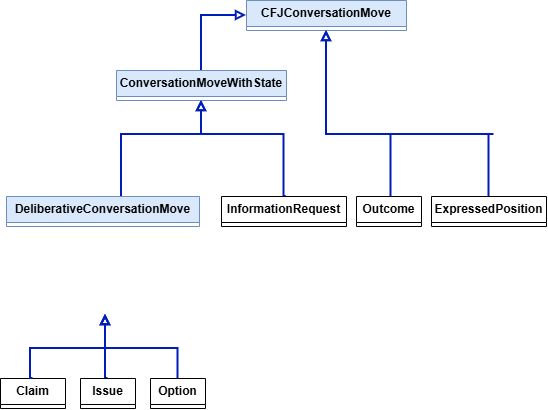
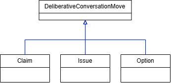
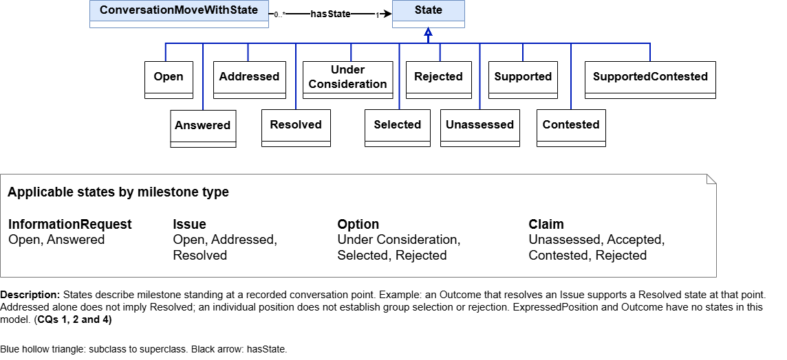
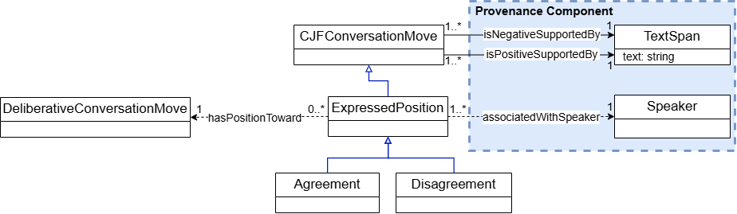
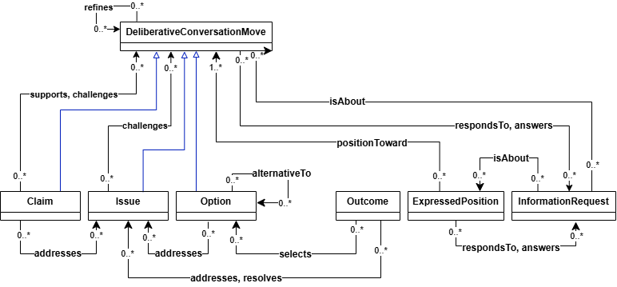
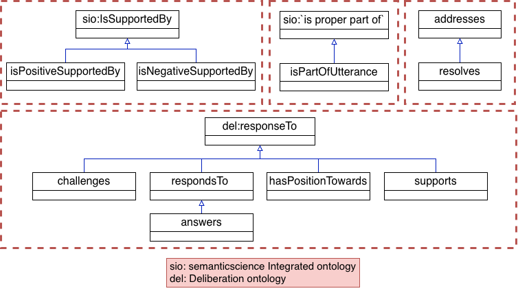
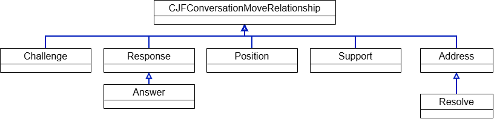
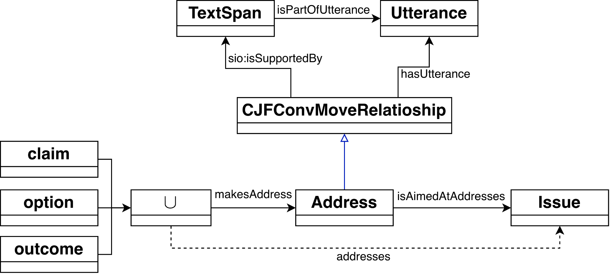

[Ontologies](#ontologies) | [Ontology Versions](#ontology-versions) | [Conceptual Model](#conceptual-model) | [Ontologies Reused](#ontologies-reused) | [Ontology Prefixes](#ontology-prefixes)

## Ontologies

### Current CJF Ontology

[Download OE_8_TeamCJF.rdf](OE_8_TeamCJF.rdf)

The Tracking Collective Judgment Formation ontology represents conversation moves, their relationships, transcript evidence, provenance, and state assignment histories. Its namespace is `https://tw.rpi.edu/ontology-engineering/oe2026/tracking-cjf/`. See the [current use case](usecase.html) for the intended questions and the [latest term list](termlist.html) for terminology and sources.

### Example Individuals and Supporting Files

These files accompany the schema; they are not separate releases of the ontology.

| File | Purpose |
| --- | --- |
| [CQ sample conversation](OE_8_TeamCJF_Individuals.rdf) | Conversation, utterances, speakers, conversation moves, evidence, relationships, and state assignments used for the competency question examples |
| [March 11 Group B individuals](mar11_groupb-individuals.rdf) | Annotated example individuals from a corpus conversation |
| [Earlier conversation individuals](tracking-cjf-individuals.rdf) | Earlier instance dataset retained alongside the current examples |
| [Ontology import catalog](catalog-v001.xml) | Local mappings used to resolve ontology imports |
| [Local PROV-O copy](prov-o-cjf.owl) | Provenance vocabulary used by the project |
| [Current state assignment SHACL rules](shacl/current-state-assignment-rules.ttl) | Rules and constraints for identifying the latest recorded assignment for each move with state |

## Ontology Versions

The [current schema](OE_8_TeamCJF.rdf) appears first above. The [complete ontology version list](ontology-versions.html) links every distinct committed schema snapshot, newest first, back to the seed ontology of October 5, 2026. Immutable commit links preserve earlier versions without confusing them with example individuals or imported dependencies.

## Conceptual Model

**Current version: OE Week 8.** [Download the complete conceptual model (.docx)](files/conceptual-models/oe8/OE_8_TeamCJF_ConceptualModel.docx).

The ten diagrams below show the project's conceptual model. Click an image to view it at full size. The diagrams use abbreviated labels for readability; the RDF schema gives the identifiers used in code and queries.

### Provenance

<figure>
  
  <figcaption>Figure 1. Transcript evidence and speaker provenance for conversation moves.</figcaption>
</figure>

Each conversation move is supported by a TextSpan within an Utterance. The utterance records its turn number, conversation, and attributed Speaker. These connections let queries retrieve the original text and the person responsible for a contribution, supporting the evidence and speaker questions in CQs 5–7.

### Conversation Moves with States

<figure>
  
  <figcaption>Figure 2. Conversation move taxonomy and the branch for moves with states.</figcaption>
</figure>

ConversationMoveWithState groups DeliberativeConversationMove and InformationRequest. Outcome and ExpressedPosition remain directly under the general conversation move class. This distinction supports CQ1: every relevant move can be retrieved, while state information is included where it applies.

### Deliberative Conversation Moves

<figure>
  
  <figcaption>Figure 3. Claim, Issue, and Option as deliberative conversation moves.</figcaption>
</figure>

Claim, Issue, and Option introduce or develop the substance of the group's reasoning. Each is a DeliberativeConversationMove and therefore a ConversationMoveWithState. Grouping these classes allows common relationships and state history patterns to be represented consistently.

### State Taxonomy

<figure>
  
  <figcaption>Figure 4. State taxonomy and its association with conversation moves.</figcaption>
</figure>

States characterize a move's standing at a recorded conversation point. Information requests can be open or answered; issues can be open, addressed, or resolved; options can be under consideration, selected, or rejected; and claims can be unassessed, supported, or contested. Supported and Contested classifications can coexist. State information supports CQ1 and the issue-focused questions CQ2 and CQ4.

The supplied figure's lower inset retains some earlier terminology, including “milestone” and “Accepted.” The current RDF class names and the latest term list should be used when constructing queries.

### State Assignment History

<figure>
  
  <figcaption>Figure 5. Evidence-backed state assignments, triggering relationships, and an example history.</figcaption>
</figure>

A StateAssignment connects a move to its assigned State, the Utterance at which it applies, its evidence TextSpan, and optionally the preceding assignment for the same move. An initial assignment has no predecessor. The example illustrates retaining earlier records as new assignments are added. In the implementation, `hasCurrentStateAssignment` identifies the terminal assignment, and `hasState` follows that assignment's `assignedState` link. Rule-based transitions also record the relevant relationship through `hasTriggeringRelationship`.

### Expressed Positions

<figure>
  
  <figcaption>Figure 6. Expressed positions, polarity evidence, and speaker attribution.</figcaption>
</figure>

Agreement and Disagreement specialize ExpressedPosition. Positive or negative supporting text provides evidence for the position, which is directed toward another conversation move and associated with a speaker. These links support questions about who agreed with the selected option and how a participant's positions developed, as in CQs 5–7.

### Relationships between Conversation Moves

<figure>
  
  <figcaption>Figure 7. Semantic relationships among the conversation move types.</figcaption>
</figure>

The model connects claims, issues, options, outcomes, positions, and information requests through relationships such as supports, challenges, answers, addresses, resolves, and selects. These links expose the structure of the group's reasoning. Their evidence also contributes to state interpretation and to retrieving the contributions relevant to a particular option or issue.

### Property Hierarchy

<figure>
  
  <figcaption>Figure 8. Subproperty relationships and reused vocabulary.</figcaption>
</figure>

The four segments group evidence properties, text containment, addressing and resolving, and conversational responses. Positive and negative support specialize the evidence relationship; resolves specializes addresses; and answers specializes respondsTo. The diagram also identifies relationships drawn from SIO and the Deliberation Ontology.

### Relationship Class Taxonomy

<figure>
  
  <figcaption>Figure 9. Class hierarchy for reified conversation move relationships.</figcaption>
</figure>

Relationships can be represented as individuals of CollectiveJudgmentFormationConversationMoveRelationship. Its specialized classes include Challenge, Response, Position, Support, and Address. Answer specializes Response, and Resolve specializes Address. Giving relationships their own individuals allows evidence and contextual information to be attached to the connection itself.

### Relationship Reification

<figure>
  
  <figcaption>Figure 10. Reifying an Address relationship and retaining its evidence.</figcaption>
</figure>

A source conversation move connects to an Address individual, which identifies the target Issue. The relationship individual is supported by a TextSpan in an Utterance. A property chain derives the direct addresses relationship from the source-to-relationship and relationship-to-target links. The same pattern lets queries retrieve both how two moves are connected and the evidence for that connection.

### Previous Conceptual Models

- [OE Week 6 conceptual model (.docx)](files/conceptual-models/oe6/OE_6_TeamCJF_ConceptualModel.docx)
- [OE Week 6 diagrams](images/conceptual-model/oe6/milestones_relationships-ProvinanceV3.drawio.png) — earlier figure assets remain in `images/conceptual-model/oe6/`.
- [OE Week 5 diagrams](images/conceptual-model/oe5/milestones_relationships-ProvenanceConceptualDiagram.png) — earlier figure assets remain in `images/conceptual-model/oe5/`.

## Ontologies Reused

- [PROV-O](https://www.w3.org/TR/prov-o/) provides provenance concepts and relationships for activities, entities, and speaker attribution. A [local copy](prov-o-cjf.owl) accompanies the project.
- [Semanticscience Integrated Ontology (SIO)](https://semanticscience.org/) supplies evidence and containment relationships used by the model.
- [Deliberation Knowledge Graph](https://dkg.svagnoni.linkeddata.es/) supplies vocabulary for deliberative relationships.
- [OMG Commons Annotation Vocabulary](https://www.omg.org/spec/Commons/AnnotationVocabulary/) and [Dates and Times](https://www.omg.org/spec/Commons/DatesAndTimes/) provide annotation and temporal vocabulary referenced in the ontology.

### Conceptual Model References

1. M. Dumontier et al., “The Semanticscience Integrated Ontology (SIO) for biomedical research and knowledge discovery,” *Journal of Biomedical Semantics*, vol. 5, Art. no. 14, 2014. [https://doi.org/10.1186/2041-1480-5-14](https://doi.org/10.1186/2041-1480-5-14)
2. S. Vagnoni, “Deliberation Knowledge Graph.” Accessed October 13, 2026. [https://dkg.svagnoni.linkeddata.es/](https://dkg.svagnoni.linkeddata.es/)

## Ontology Prefixes

| Prefix | Namespace |
| --- | --- |
| cjf | `https://tw.rpi.edu/ontology-engineering/oe2026/tracking-cjf/` |
| rdf | `http://www.w3.org/1999/02/22-rdf-syntax-ns#` |
| rdfs | `http://www.w3.org/2000/01/rdf-schema#` |
| owl | `http://www.w3.org/2002/07/owl#` |
| xsd | `http://www.w3.org/2001/XMLSchema#` |
| dct | `http://purl.org/dc/terms/` |
| skos | `http://www.w3.org/2004/02/skos/core#` |
| prov | `http://www.w3.org/ns/prov#` |
| sio | `http://semanticscience.org/resource/` |
| del | `https://w3id.org/deliberation/ontology#` |
| AnnotationVocabulary | `https://www.omg.org/spec/Commons/AnnotationVocabulary/` |
| DatesAndTimes | `https://www.omg.org/spec/Commons/DatesAndTimes/` |
