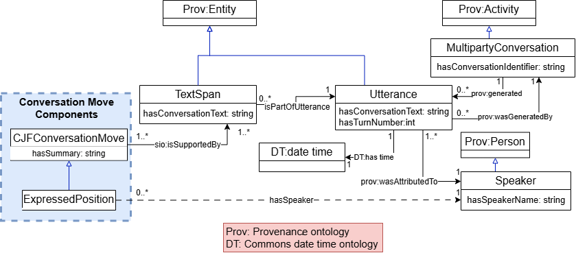
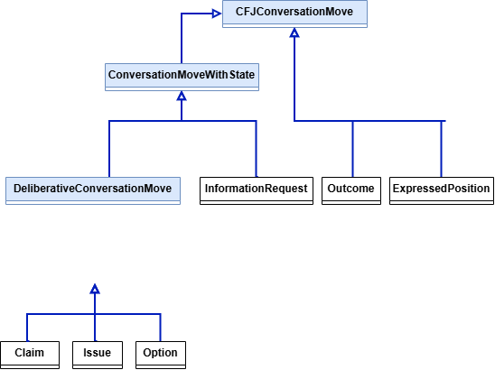
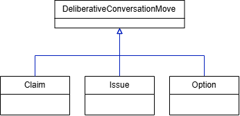
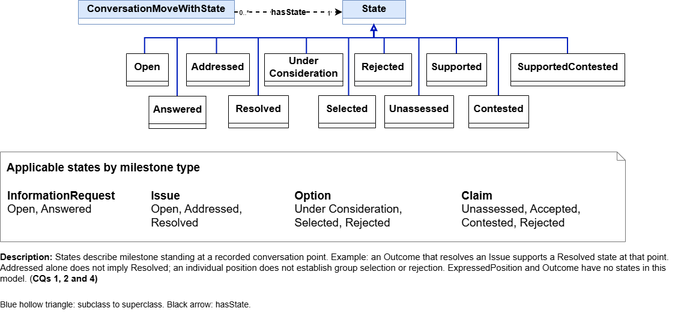
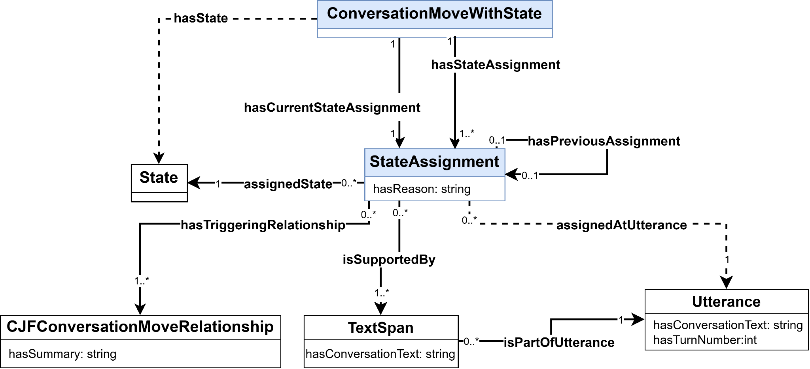
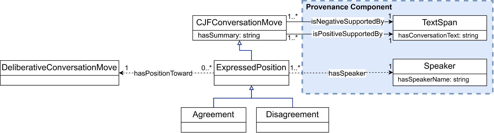
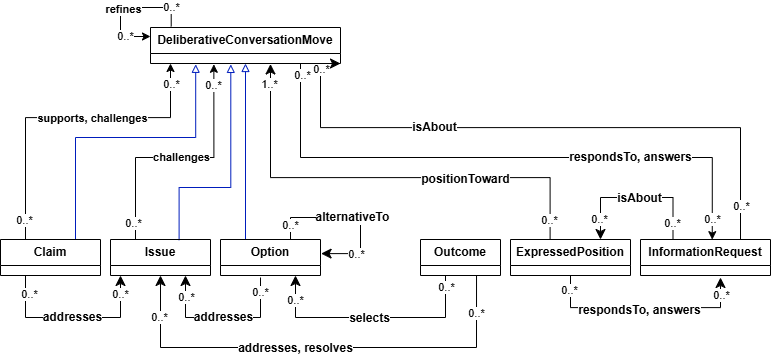
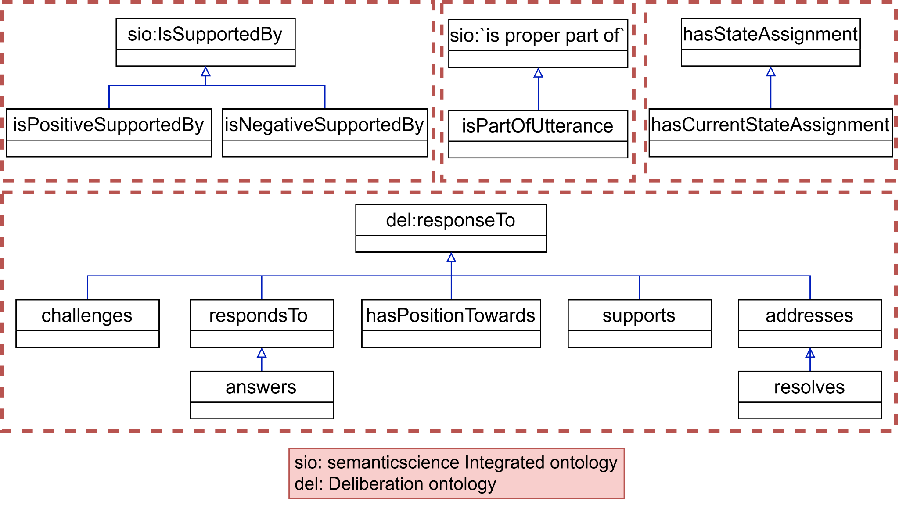
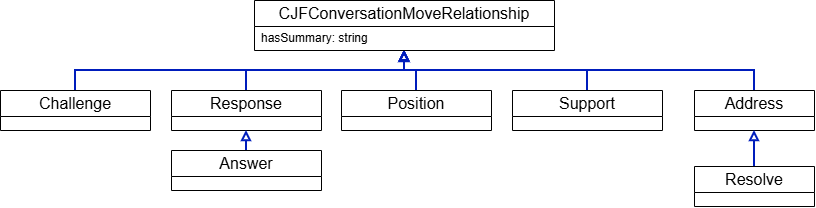
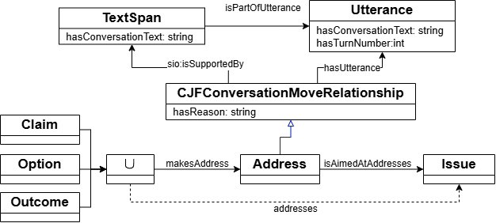

[Ontologies](#ontologies) | [Ontology Versions](#ontology-versions) | [Conceptual Model](#conceptual-model) | [Ontologies Reused](#ontologies-reused) | [Ontology Prefixes](#ontology-prefixes)

## Ontologies

### Current CJF Ontology

[Download OE_10_TeamCJF.rdf](ontology/OE_10_TeamCJF.rdf)

The Tracking Collective Judgment Formation ontology represents conversation moves, their relationships, transcript evidence, provenance, and state assignment histories. Its namespace is `https://tw.rpi.edu/ontology-engineering/oe2026/tracking-cjf/`. See the [current use case](usecase.html) for the intended questions and the [latest term list](termlist.html) for terminology and sources.

### Example Individuals and Supporting Files

These files accompany the schema; they are not separate releases of the ontology.

| File | Purpose |
| --- | --- |
| [Annotated CQ sample individuals](ontology/OE_10_TeamCJF_Individuals_withoutCurrentState.rdf) | Conversation moves, speakers, evidence, relationships, and state-assignment histories generated from the annotations |
| [CQ sample individuals with current assignments](ontology/OE_10_TeamCJF_Individuals.rdf) | The same data with current-state-assignment links added by SHACL; use this file for CQ1, CQ2, CQ3, CQ5, and CQ6 |
| [March 11 Group B individuals](ontology/mar11_groupb-individuals.rdf) | Annotated example individuals from a corpus conversation |
| [Earlier conversation individuals](ontology/tracking-cjf-individuals.rdf) | Earlier instance dataset retained alongside the current examples |
| [Ontology import catalog](ontology/catalog-v001.xml) | Local mappings used to resolve ontology imports |
| [Local PROV-O copy](ontology/prov-o-cjf.owl) | Provenance vocabulary used by the project |
| [Current state assignment SHACL rules](shacl/current-state-assignment-rules.ttl) | Rules and constraints for identifying the latest recorded assignment for each move with state |

## Ontology Versions

The [current schema](ontology/OE_10_TeamCJF.rdf) appears first above. See the [ontology version history](ontology-versions.html) for the current ontology and earlier versions. Immutable commit links preserve earlier versions without confusing them with example individuals or imported dependencies.

## Conceptual Model

**Current version: OE Week 10.**

 - [Download the conceptual model (.docx)](files/conceptual-models/oe10/OE_10_TeamCJF_ConceptualModel.docx)
 - [Download the conceptual model (.pdf)](files/conceptual-models/oe10/OE_10_TeamCJF_ConceptualModel.pdf)

The ten diagrams below are the figures from the OE Week 10 conceptual model document, in document order. The DOCX and PDF downloads contain the same figures and descriptions. Click an image to view it at full size. The diagrams use abbreviated labels for readability; the [RDF schema](ontology/OE_10_TeamCJF.rdf) gives the identifiers used in code and queries.

### Provenance

<figure>
  
  <figcaption>Figure 1. Transcript evidence and speaker provenance for conversation moves.</figcaption>
</figure>

Each conversation move is supported by a TextSpan, and each TextSpan is part of an Utterance. The utterance records its text, turn number, and time. It is generated by a MultipartyConversation and attributed to a Speaker. A property chain over these links infers `hasSpeaker`, which CQ5 and CQ6 use to identify who expressed a position. Those questions also return the supporting TextSpan and its turn number as evidence.

### Conversation Moves with States

<figure>
  
  <figcaption>Figure 2. Conversation move taxonomy and the branch for moves with states.</figcaption>
</figure>

ConversationMoveWithState groups DeliberativeConversationMove and InformationRequest, the moves whose states change during a conversation. Outcome and ExpressedPosition sit directly under the general conversation move class because they have no states. This distinction supports CQ1, which lists every move and reports a state only where one applies. The Claim, Issue, and Option group at the bottom is expanded in the next figure.

### Deliberative Conversation Moves

<figure>
  
  <figcaption>Figure 3. Claim, Issue, and Option as deliberative conversation moves.</figcaption>
</figure>

DeliberativeConversationMove has three subclasses: Claim, Issue, and Option. Each is also a ConversationMoveWithState, so CQ1 reports state information for all three.

### State Taxonomy

<figure>
  
  <figcaption>Figure 4. State taxonomy and the states that apply to each move type.</figcaption>
</figure>

Each ConversationMoveWithState is linked to its State through `hasState`. Each move with states has one current State, and any number of moves can share a State. The inset lists the states that apply to Information Requests, Issues, Options, and Claims. These states support CQ1 and the questions about Addressed and Resolved Issues in CQ2 and CQ4. The figure still shows SupportedContested, which the Week 10 schema and term list no longer define.

### State Assignment History

<figure>
  
  <figcaption>Figure 5. Current and historical state assignments with evidence and triggering relationships.</figcaption>
</figure>

Moves with states keep their state history as the current State changes. A move has one or more StateAssignment records through `hasStateAssignment`; its subproperty `hasCurrentStateAssignment` identifies the current one. Each StateAssignment records the State it assigns, the Utterance at which it applies, its supporting TextSpan, and a reason. `hasPreviousAssignment` links an assignment to the preceding one for the same move, so state changes can be traced through the conversation. `hasTriggeringRelationship` records the relationship that triggered a rule-based transition. The reasoner derives `hasState` from the current assignment's `assignedState`.

### Expressed Positions

<figure>
  
  <figcaption>Figure 6. Expressed positions, polarity evidence, and speaker attribution.</figcaption>
</figure>

Agreement and Disagreement specialize ExpressedPosition, which is itself a conversation move. The reasoner infers the subclass from the supporting evidence: `isPositiveSupportedBy` indicates Agreement, and `isNegativeSupportedBy` indicates Disagreement. `hasPositionTowards` links the position to its target move, and `hasSpeaker` links it to the Speaker. Together with turn information, these links support CQ5 and CQ6.

### Relationships between Conversation Moves

<figure>
  
  <figcaption>Figure 7. Semantic relationships among the conversation move types.</figcaption>
</figure>

The model connects claims, issues, options, outcomes, positions, and information requests through relationships such as supports, challenges, answers, addresses, resolves, and selects. These links let queries retrieve related contributions and provide evidence for determining move states. Combined with state information and the links to speakers and turns, they support all the competency questions.

### Property Hierarchy

<figure>
  
  <figcaption>Figure 8. Subproperty relationships and reused vocabulary.</figcaption>
</figure>

The four groups cover evidence, text containment, state assignment, and responses. Positive and negative support specialize SIO's `isSupportedBy`, and `isPartOfUtterance` specializes SIO's `is proper part of`. `hasCurrentStateAssignment` specializes `hasStateAssignment`. `challenges`, `respondsTo`, `hasPositionTowards`, `supports`, and `addresses` fall under the Deliberation Ontology's `responseTo`. Below them, `answers` specializes `respondsTo` and `resolves` specializes `addresses`.

### Relationship Class Taxonomy

<figure>
  
  <figcaption>Figure 9. Class hierarchy for reified conversation move relationships.</figcaption>
</figure>

Relationships between conversation moves can be reified as individuals of CollectiveJudgmentFormationConversationMoveRelationship. Its subclasses are Challenge, Response, Position, Support, and Address. Answer specializes Response, and Resolve specializes Address.

### Relationship Reification

<figure>
  
  <figcaption>Figure 10. Reifying an Address relationship and retaining its evidence.</figcaption>
</figure>

Each relationship between conversation moves is an individual that connects a source move to a target move, so evidence and other context can be attached to the relationship itself. In the example, a Claim, Option, or Outcome connects to an Address individual through `makesAddresses`, and the Address identifies the target Issue through `isAimedAtAddresses`. A property chain over these two links infers the direct `addresses` relationship. The relationship records its reason, its supporting TextSpan, and its Utterance. The same pattern applies to supports, challenges, respondsTo, answers, resolves, and hasPositionTowards.

### Previous Conceptual Models

- OE Week 9 conceptual model: [.docx](files/conceptual-models/oe9/OE_9_TeamCJF_ConceptualModel.docx), [.pdf](files/conceptual-models/oe9/OE_9_TeamCJF_ConceptualModel.pdf), and [editable diagrams (.drawio)](files/conceptual-models/oe9/OE_9_TeamCJF_ConceptualModel.drawio). Its figures remain in `images/conceptual-model/oe9/`, and the [asset notes](files/conceptual-models/oe9/README.md) describe how they were prepared.
- [OE Week 8 conceptual model (.docx)](files/conceptual-models/oe8/OE_8_TeamCJF_ConceptualModel.docx)
- [OE Week 6 conceptual model (.docx)](files/conceptual-models/oe6/OE_6_TeamCJF_ConceptualModel.docx)
- [OE Week 6 diagrams](images/conceptual-model/oe6/milestones_relationships-ProvinanceV3.drawio.png) — earlier figure assets remain in `images/conceptual-model/oe6/`.
- [OE Week 5 diagrams](images/conceptual-model/oe5/milestones_relationships-ProvenanceConceptualDiagram.png) — earlier figure assets remain in `images/conceptual-model/oe5/`.

## Ontologies Reused

- [PROV-O](https://www.w3.org/TR/prov-o/) provides provenance concepts and relationships for activities, entities, and speaker attribution. A  [local copy](ontology/prov-o-cjf.owl) accompanies the project.
- [Semanticscience Integrated Ontology (SIO)](https://semanticscience.org/) supplies evidence and containment relationships used by the model.
- [Deliberation Knowledge Graph](https://dkg.svagnoni.linkeddata.es/) supplies vocabulary for deliberative relationships.
- [OMG Commons Annotation Vocabulary](https://www.omg.org/spec/Commons/AnnotationVocabulary/) and [Dates and Times](https://www.omg.org/spec/Commons/DatesAndTimes/) provide annotation and temporal vocabulary referenced in the ontology.

### Conceptual Model References

1. M. Dumontier et al., “The Semanticscience Integrated Ontology (SIO) for biomedical research and knowledge discovery,” *Journal of Biomedical Semantics*, vol. 5, Art. no. 14, 2014. [https://doi.org/10.1186/2041-1480-5-14](https://doi.org/10.1186/2041-1480-5-14)
2. S. Vagnoni, “Deliberation Knowledge Graph.” Accessed October 13, 2026. [https://dkg.svagnoni.linkeddata.es/](https://dkg.svagnoni.linkeddata.es/)
3. T. Lebo, S. Sahoo, and D. McGuinness, Eds., “PROV-O: The PROV Ontology,” W3C Recommendation, April 30, 2013. [https://www.w3.org/TR/prov-o/](https://www.w3.org/TR/prov-o/)

## Ontology Prefixes

| Prefix | Namespace |
| --- | --- |
| cjf | `https://tw.rpi.edu/ontology-engineering/oe2026/tracking-cjf/` |
| rdf | `http://www.w3.org/1999/02/22-rdf-syntax-ns#` |
| rdfs | `http://www.w3.org/2000/01/rdf-schema#` |
| owl | `http://www.w3.org/2002/07/owl#` |
| xsd | `http://www.w3.org/2001/XMLSchema#` |
| dct | `http://purl.org/dc/terms/` |
| skos | `http://www.w3.org/2004/02/skos/core#` |
| prov | `http://www.w3.org/ns/prov#` |
| sio | `http://semanticscience.org/resource/` |
| del | `https://w3id.org/deliberation/ontology#` |
| AnnotationVocabulary | `https://www.omg.org/spec/Commons/AnnotationVocabulary/` |
| DatesAndTimes | `https://www.omg.org/spec/Commons/DatesAndTimes/` |
