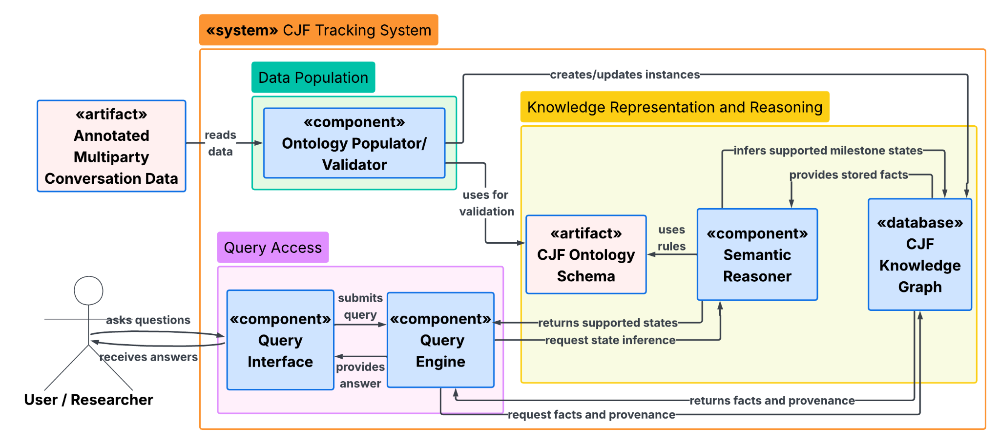

## Tracking Collective Judgment Formation in Multiparty Dialogue

How does a group develop a judgment over the course of a conversation? Our ontology represents the contributions that shape that process: information requests, issues, options, claims, expressed positions, and outcomes. It connects these conversation moves to one another, to their speakers, and to the transcript passages that provide evidence for them.

For conversation moves with states, the model records each state assignment, its effective utterance, its supporting evidence, and the preceding assignment. This history lets a researcher ask what has been discussed, which issues remain open, what supports or challenges an option, and how participants' positions develop. The project represents the group's reasoning and its provenance; it does not decide whether the group's judgment is correct.

## Team

This project is part of the Ontology Engineering course at Rensselaer Polytechnic Institute, Fall 2026.

| Team member | Website or profile | GitHub | Contact |
| --- | --- | --- | --- |
| Tiziana Hernandez | [TWC profile](https://tw.rpi.edu/person/tiziana-hernandez) | [thernandez7](https://github.com/thernandez7) | [hernat@rpi.edu](mailto:hernat@rpi.edu) |
| Devin De Silva | [TWC profile](https://tw.rpi.edu/person/devin-de-silva) | [DevinDeSilva](https://github.com/DevinDeSilva) | [desild@rpi.edu](mailto:desild@rpi.edu) |
| Srihari Sridharan | [TWC profile](https://tw.rpi.edu/person/srihari-sridharan) | [sridhs3](https://github.com/sridhs3) | [sridhs3@rpi.edu](mailto:sridhs3@rpi.edu) |
| Matthew Lausev | [LinkedIn](https://www.linkedin.com/in/matthew-lausev-742691410) | [mlau-hue](https://github.com/mlau-hue) | [lausem@rpi.edu](mailto:lausem@rpi.edu) |

## Project Model

<figure>
  
  <figcaption>Figure 1. High-level component overview from the OE Week 11 use case.</figcaption>
</figure>

Annotated conversation data populates the CJF knowledge graph and is validated against the ontology schema. The semantic reasoner uses the schema's rules to infer supported states, while the query engine retrieves facts, provenance, and state information for the user. The [use case](usecase.html) describes this workflow and the questions it supports. The [conceptual model page](ontology.html#conceptual-model) shows the ontology's classes and relationships.

## Current Resources

**OE Week 11** updates the use case, terminology, ontology, individuals, conceptual diagrams, and query demonstrations.

| Resource | Contents |
| --- | --- |
| [Use case](usecase.html) | OE Week 11 project scope and competency questions, plus earlier versions |
| [Terminology list](termlist.html) | OE Week 11 curated terminology workbook and earlier versions |
| [Conceptual model and ontology](ontology.html) | Current diagrams, schema, example individuals, reused vocabularies, and ontology versions |
| [Ontology version history](ontology-versions.html) | Schema and individuals downloads for OE Weeks 8–11, plus development snapshots |
| [Demonstration and queries](demo.html) | CQ1, CQ2, CQ3, CQ5, and CQ6 queries and recorded answers for the sample conversation |
| [Presentations](presentations.html) | Project proposal and course presentations |
| [Getting involved](gettinginvolved.html) | Project contacts and contribution information |
