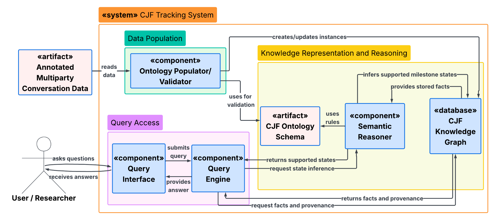

## Tracking Collective Judgment Formation in Multiparty Dialogue

How does a group develop a judgment over the course of a conversation? Our ontology represents the contributions that shape that process: information requests, issues, options, claims, expressed positions, and outcomes. It connects these conversation moves to one another, to their speakers, and to the transcript passages that provide evidence for them.

For conversation moves with states, the model records each state assignment, its effective utterance, its supporting evidence, and the preceding assignment. This history lets a researcher ask what has been discussed, which issues remain open, what supports or challenges an option, and how participants' positions develop. The project represents the group's reasoning and its provenance; it does not decide whether the group's judgment is correct.

Because each recorded state change keeps its evidence, researchers can check why the model reports an issue as open or resolved, compare how judgments form across discussions, and reuse the same queries on newly annotated conversations. The state histories can also support facilitation tools that point a moderator to issues the group has not yet addressed, as our facilitation prototype does for one sample discussion.

## Team

This project is part of the [Ontology Engineering course](https://tw.rpi.edu/courses/Ontologies) at Rensselaer Polytechnic Institute, Fall 2026.

| Team member | Website or profile | GitHub | Contact |
| --- | --- | --- | --- |
| Tiziana Hernandez | [TWC profile](https://tw.rpi.edu/person/tiziana-hernandez) | [thernandez7](https://github.com/thernandez7) | [hernat@rpi.edu](mailto:hernat@rpi.edu) |
| Devin De Silva | [TWC profile](https://tw.rpi.edu/person/devin-de-silva) | [DevinDeSilva](https://github.com/DevinDeSilva) | [desild@rpi.edu](mailto:desild@rpi.edu) |
| Srihari Sridharan | [TWC profile](https://tw.rpi.edu/person/srihari-sridharan) | [sridhs3](https://github.com/sridhs3) | [sridhs3@rpi.edu](mailto:sridhs3@rpi.edu) |
| Matthew Lausev | [LinkedIn](https://www.linkedin.com/in/matthew-lausev-742691410) | [mlau-hue](https://github.com/mlau-hue) | [lausem@rpi.edu](mailto:lausem@rpi.edu) |

## Project Model

<figure>
  
  <figcaption>Figure 1. High-level component overview from the OE Week 11 use case.</figcaption>
</figure>

Annotated conversation data populates the CJF knowledge graph and is validated against the ontology schema. The semantic reasoner uses the schema's rules to infer supported states, while the query engine retrieves facts, provenance, and state information for the user. The [use case](usecase.html) describes this workflow and the questions it supports. The [conceptual model page](ontology.html#conceptual-model) shows the ontology's classes and relationships.

## Demonstration

The demonstration follows a 28-turn discussion in which four speakers choose between two software platforms. It answers six competency questions about that discussion: which moves occurred, which issues were addressed or resolved, which claims bear on Platform A, how those issues changed state, who agreed with the final choice, and how one speaker's position shifted.

- [Static demonstration and queries](demo.html): each question's SPARQL query, its recorded answers, and the reasoner steps to reproduce them in Protégé
- [Competency question graphs](answer-graphs.html): step through a worked answer and see which RDF links each query pattern matches
- [Facilitation prototype](facilitator.html): replay the discussion turn by turn and see which issues were open at each point

## Use, Extend, or Give Feedback

The ontology, example individuals, and queries are available under the [MIT License](license.html). Try the queries on your own annotated conversations, reuse the conversation move and state assignment patterns in your own models, or tell us where the model does not fit your data. The [Getting Involved](gettinginvolved.html) page describes how to report issues and contribute, and the project files are on [GitHub](https://github.com/tetherless-world/ontology-engineering/tree/master/oe2026/tracking-cjf).

## Current Resources

The current release is **version 1.0** of the ontology and sample individuals, with the OE Week 13 use case and terminology and the OE Week 11 conceptual diagrams.

| Resource | Contents |
| --- | --- |
| [Competency question graphs](answer-graphs.html) | Explore the RDF links and SPARQL steps behind worked answers to CQ1–CQ6 |
| [Use case](usecase.html) | OE Week 13 project scope and competency questions, plus earlier versions |
| [Terminology list](termlist.html) | OE Week 13 curated term list and earlier versions |
| [Conceptual model and ontology](ontology.html) | Diagrams, the 1.0 schema and individuals, validation results, and reused vocabularies |
| [Ontology version history](ontology-versions.html) | Schema and individuals downloads for 1.0 and OE Weeks 8–13, plus development snapshots |
| [Demonstration and queries](demo.html) | CQ1–CQ6 queries and recorded answers for the sample conversation |
| [Facilitation prototype](facilitator.html) | Replay the sample discussion and inspect evidence for suggested follow-up questions |
| [Presentations](presentations.html) | Project proposal and course presentations |
| [Publications](publications.html) | Project report outline (PDF) |
| [Getting involved](gettinginvolved.html) | Maintenance policy, project contacts, and contribution information |
