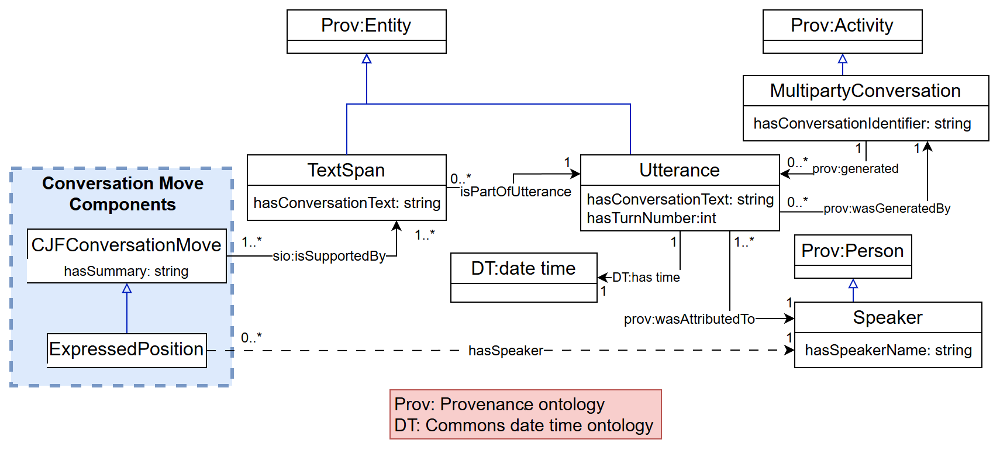
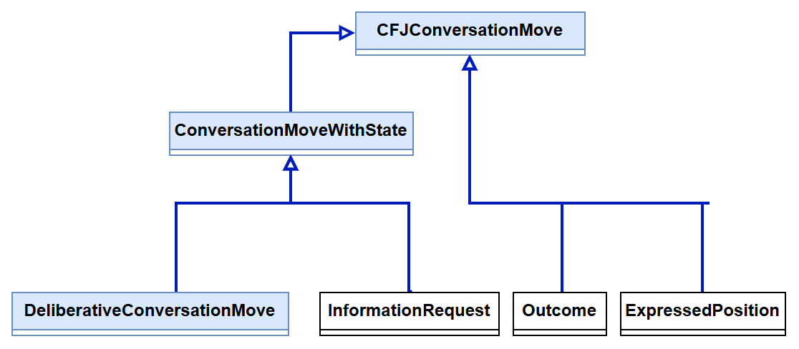
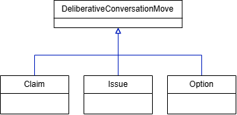
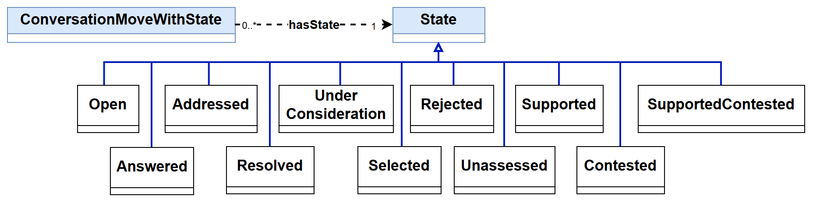
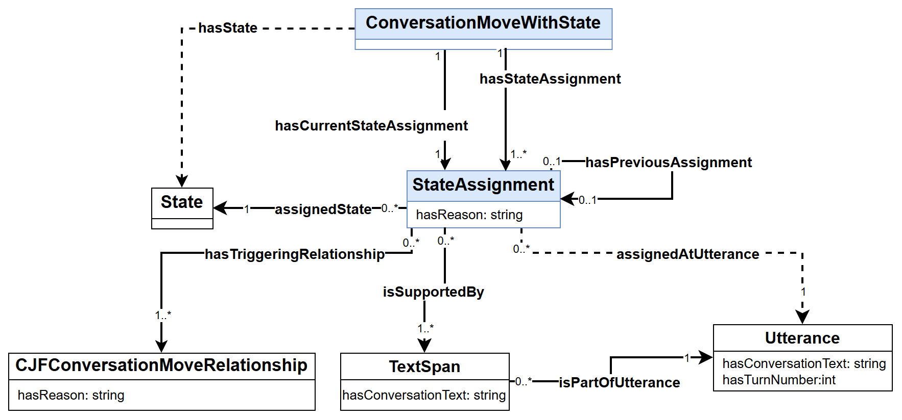
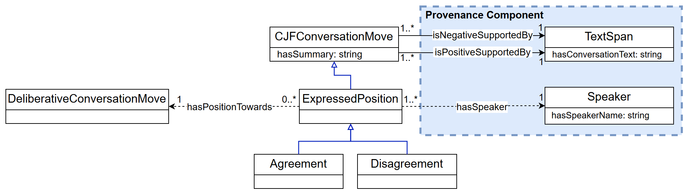
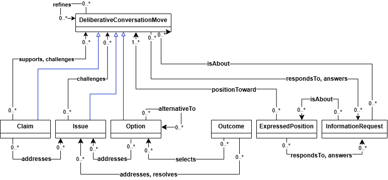
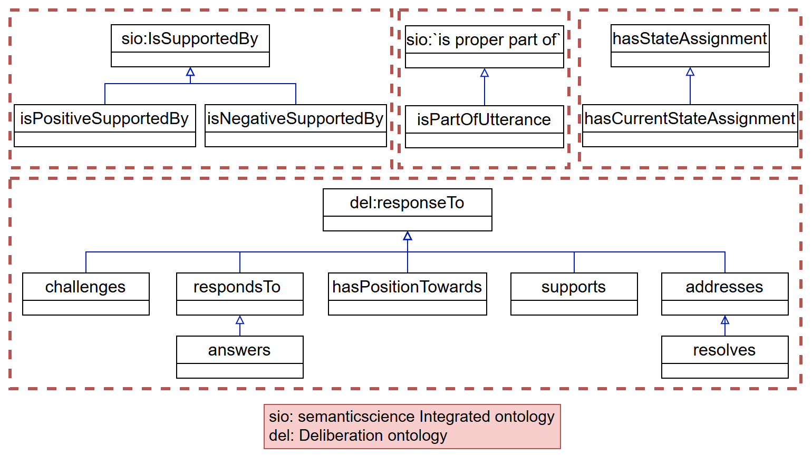
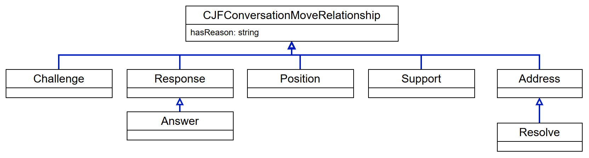
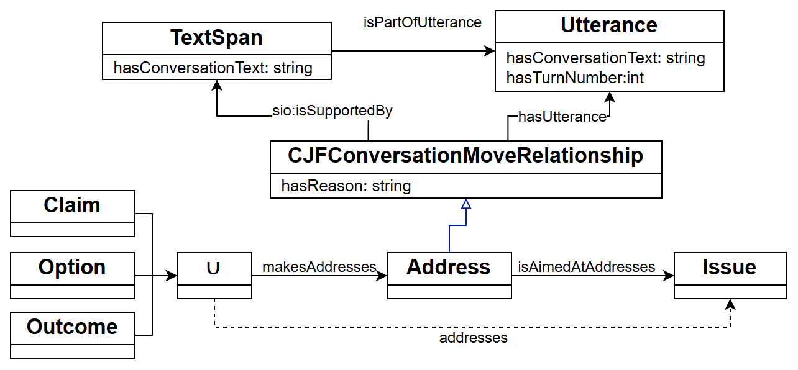

[Ontologies](#ontologies) | [Ontology Versions](#ontology-versions) | [Conceptual Model](#conceptual-model) | [Ontologies Reused](#ontologies-reused) | [Ontology Prefixes](#ontology-prefixes)

## Ontologies

### Current CJF Ontology

[Download OE_10_TeamCJF.rdf](ontology/OE_10_TeamCJF.rdf)

The Tracking Collective Judgment Formation ontology represents conversation moves, their relationships, transcript evidence, provenance, and state assignment histories. Its namespace is `https://tw.rpi.edu/ontology-engineering/oe2026/tracking-cjf/`. See the [current use case](usecase.html) for the intended questions and the [latest term list](termlist.html) for terminology and sources.

### Example Individuals and Supporting Files

These files accompany the schema; they are not separate releases of the ontology.

| File | Purpose |
| --- | --- |
| [Annotated CQ sample individuals](ontology/OE_10_TeamCJF_Individuals.rdf) | Conversation moves, speakers, evidence, relationships, and state-assignment histories generated from the annotations |
| [CQ sample individuals with current assignments](ontology/OE_10_TeamCJF_Individuals_CurrentStateAdded.rdf) | The same data with current-state-assignment links added by SHACL; use this file for CQ1, CQ3, and CQ5 |
| [March 11 Group B individuals](ontology/mar11_groupb-individuals.rdf) | Annotated example individuals from a corpus conversation |
| [Earlier conversation individuals](ontology/tracking-cjf-individuals.rdf) | Earlier instance dataset retained alongside the current examples |
| [Ontology import catalog](ontology/catalog-v001.xml) | Local mappings used to resolve ontology imports |
| [Local PROV-O copy](ontology/prov-o-cjf.owl) | Provenance vocabulary used by the project |
| [Current state assignment SHACL rules](shacl/current-state-assignment-rules.ttl) | Rules and constraints for identifying the latest recorded assignment for each move with state |

## Ontology Versions

The [current schema](ontology/OE_10_TeamCJF.rdf) appears first above. See the [ontology version history](ontology-versions.html) for the current ontology and earlier versions. Immutable commit links preserve earlier versions without confusing them with example individuals or imported dependencies.

## Conceptual Model

**Current version: OE Week 9.**

 - [Download the conceptual model (.docx)](files/conceptual-models/oe9/OE_9_TeamCJF_ConceptualModel.docx)
 - [Download the conceptual model (.pdf)](files/conceptual-models/oe9/OE_9_TeamCJF_ConceptualModel.pdf)
 - [Download the editable diagrams (.drawio)](files/conceptual-models/oe9/OE_9_TeamCJF_ConceptualModel.drawio)

The diagrams below show the current OE Week 9 conceptual model, using the supplied clean document and Draw.io source. The DOCX and PDF downloads contain the same ten figures. Click an image to view it at full size. The diagrams use abbreviated labels for readability; the RDF schema gives the identifiers used in code and queries.

### Provenance

<figure>
  
  <figcaption>Figure 1. Transcript evidence and speaker provenance for conversation moves.</figcaption>
</figure>

Each conversation move is supported by a TextSpan within an Utterance. The utterance records its text, turn number, conversation, and attributed Speaker. A property chain infers `hasSpeaker` through the evidence and utterance links. These connections let CQs 5 and 6 retrieve the original text, source turn, and person responsible for a contribution. Conversation moves also carry `hasSummary`; speakers and conversations carry their names and identifiers.

### Conversation Moves with States

<figure>
  
  <figcaption>Figure 2. Conversation move taxonomy and the branch for moves with states.</figcaption>
</figure>

ConversationMoveWithState groups DeliberativeConversationMove and InformationRequest. Outcome and ExpressedPosition remain directly under the general conversation move class. This distinction supports CQ1: every relevant move can be retrieved, while state information is included where it applies.

### Deliberative Conversation Moves

<figure>
  
  <figcaption>Figure 3. Claim, Issue, and Option as deliberative conversation moves.</figcaption>
</figure>

Claim, Issue, and Option introduce or develop the substance of the group's reasoning. Each is a DeliberativeConversationMove and therefore a ConversationMoveWithState. Grouping these classes allows common relationships and state history patterns to be represented consistently.

### State Taxonomy

<figure>
  
  <figcaption>Figure 4. State taxonomy and its association with conversation moves.</figcaption>
</figure>

### State Assignment History

<figure>
  
  <figcaption>Figure 5. Current and historical state assignments with evidence and triggering relationships.</figcaption>
</figure>

A StateAssignment connects a move to its assigned State, the Utterance at which it applies, its evidence TextSpan, and optionally the preceding assignment for the same move. An initial assignment has no predecessor. `hasStateAssignment` retains the full history; its subproperty `hasCurrentStateAssignment` identifies the terminal assignment. The reasoner derives `hasState` through that assignment's `assignedState` link. Rule-based transitions record the relevant relationship through `hasTriggeringRelationship`. Both StateAssignment and relationship records use `hasReason` for their explanations.

### Expressed Positions

<figure>
  
  <figcaption>Figure 6. Expressed positions, polarity evidence, and speaker attribution.</figcaption>
</figure>

Agreement and Disagreement specialize ExpressedPosition. The reasoner infers these classes from `isPositiveSupportedBy` and `isNegativeSupportedBy` evidence links. `hasPositionTowards` identifies the target move and `hasSpeaker` identifies the speaker. Together with source turns, these links support CQ5 about agreement with the selected option and CQ6 about a participant's positions throughout the conversation.

### Relationships between Conversation Moves

<figure>
  
  <figcaption>Figure 7. Semantic relationships among the conversation move types.</figcaption>
</figure>

The model connects claims, issues, options, outcomes, positions, and information requests through relationships such as supports, challenges, answers, addresses, resolves, and selects. These links expose the structure of the group's reasoning. Their evidence also contributes to state interpretation and to retrieving the contributions relevant to a particular option or issue.

### Property Hierarchy

<figure>
  
  <figcaption>Figure 8. Subproperty relationships and reused vocabulary.</figcaption>
</figure>

The four segments group evidence properties, text containment, state assignment properties, and conversational responses. Positive and negative support specialize the evidence relationship. `hasCurrentStateAssignment` specializes `hasStateAssignment`; `resolves` specializes `addresses`; and `answers` specializes `respondsTo`. `addresses` belongs under the Deliberation Ontology's `responseTo` property alongside the other response properties. The diagram also identifies reused SIO vocabulary.

### Relationship Class Taxonomy

<figure>
  
  <figcaption>Figure 9. Class hierarchy for reified conversation move relationships.</figcaption>
</figure>

Relationships can be represented as individuals of CollectiveJudgmentFormationConversationMoveRelationship. Its specialized classes include Challenge, Response, Position, Support, and Address. Answer specializes Response, and Resolve specializes Address. Giving relationships their own individuals allows evidence and contextual information to be attached to the connection itself. Their `hasReason` field records an explanation; `hasSummary` is reserved for conversation moves.

### Relationship Reification

<figure>
  
  <figcaption>Figure 10. Reifying an Address relationship and retaining its evidence.</figcaption>
</figure>

A source conversation move connects to an Address individual through `makesAddresses`, and the relationship identifies the target Issue through `isAimedAtAddresses`. The relationship individual records `hasReason` and is supported by a TextSpan in an Utterance. A property chain derives the direct `addresses` relationship from these two links. The same pattern lets queries retrieve both how two moves are connected and the text and turn that justify the connection.

### Previous Conceptual Models

- [OE Week 8 conceptual model (.docx)](files/conceptual-models/oe8/OE_8_TeamCJF_ConceptualModel.docx)
- [OE Week 6 conceptual model (.docx)](files/conceptual-models/oe6/OE_6_TeamCJF_ConceptualModel.docx)
- [OE Week 6 diagrams](images/conceptual-model/oe6/milestones_relationships-ProvinanceV3.drawio.png) — earlier figure assets remain in `images/conceptual-model/oe6/`.
- [OE Week 5 diagrams](images/conceptual-model/oe5/milestones_relationships-ProvenanceConceptualDiagram.png) — earlier figure assets remain in `images/conceptual-model/oe5/`.

## Ontologies Reused

- [PROV-O](https://www.w3.org/TR/prov-o/) provides provenance concepts and relationships for activities, entities, and speaker attribution. A  [local copy](ontology/prov-o-cjf.owl) accompanies the project.
- [Semanticscience Integrated Ontology (SIO)](https://semanticscience.org/) supplies evidence and containment relationships used by the model.
- [Deliberation Knowledge Graph](https://dkg.svagnoni.linkeddata.es/) supplies vocabulary for deliberative relationships.
- [OMG Commons Annotation Vocabulary](https://www.omg.org/spec/Commons/AnnotationVocabulary/) and [Dates and Times](https://www.omg.org/spec/Commons/DatesAndTimes/) provide annotation and temporal vocabulary referenced in the ontology.

### Conceptual Model References

1. M. Dumontier et al., “The Semanticscience Integrated Ontology (SIO) for biomedical research and knowledge discovery,” *Journal of Biomedical Semantics*, vol. 5, Art. no. 14, 2014. [https://doi.org/10.1186/2041-1480-5-14](https://doi.org/10.1186/2041-1480-5-14)
2. S. Vagnoni, “Deliberation Knowledge Graph.” Accessed October 13, 2026. [https://dkg.svagnoni.linkeddata.es/](https://dkg.svagnoni.linkeddata.es/)

## Ontology Prefixes

| Prefix | Namespace |
| --- | --- |
| cjf | `https://tw.rpi.edu/ontology-engineering/oe2026/tracking-cjf/` |
| rdf | `http://www.w3.org/1999/02/22-rdf-syntax-ns#` |
| rdfs | `http://www.w3.org/2000/01/rdf-schema#` |
| owl | `http://www.w3.org/2002/07/owl#` |
| xsd | `http://www.w3.org/2001/XMLSchema#` |
| dct | `http://purl.org/dc/terms/` |
| skos | `http://www.w3.org/2004/02/skos/core#` |
| prov | `http://www.w3.org/ns/prov#` |
| sio | `http://semanticscience.org/resource/` |
| del | `https://w3id.org/deliberation/ontology#` |
| AnnotationVocabulary | `https://www.omg.org/spec/Commons/AnnotationVocabulary/` |
| DatesAndTimes | `https://www.omg.org/spec/Commons/DatesAndTimes/` |
