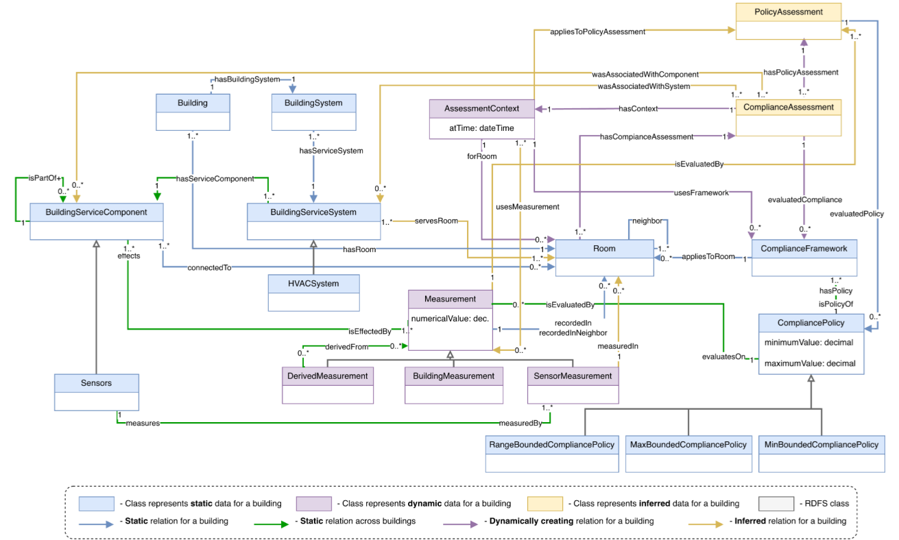
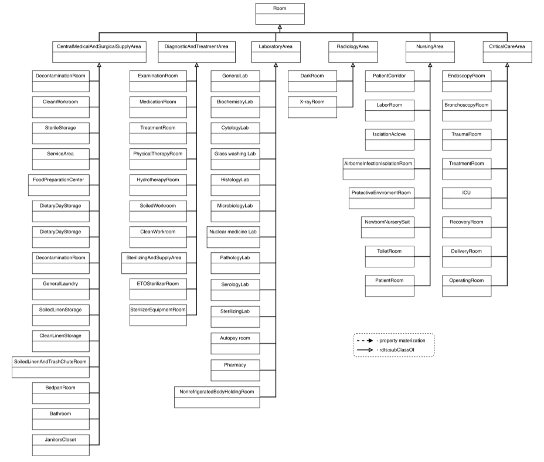
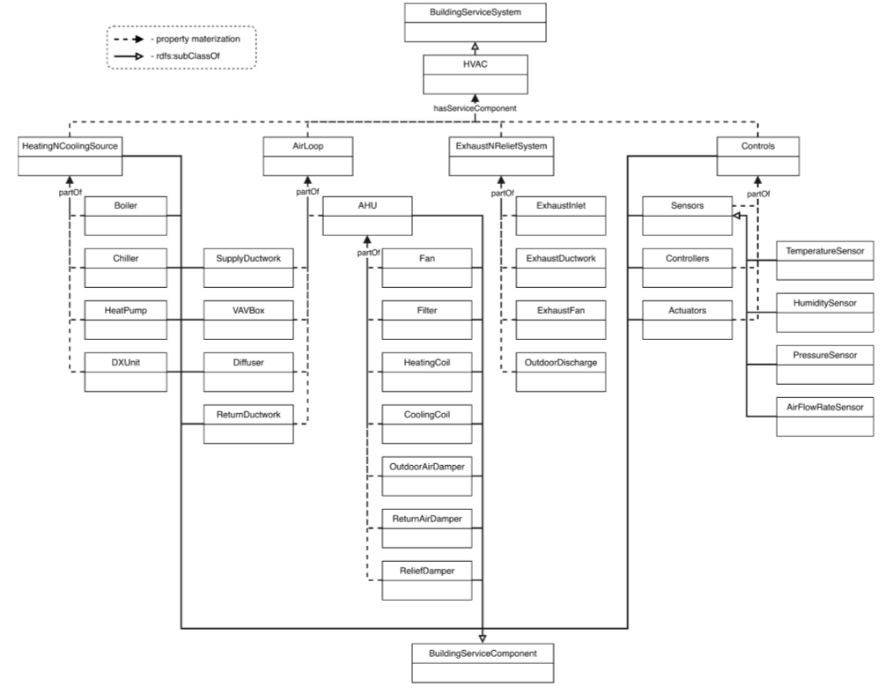
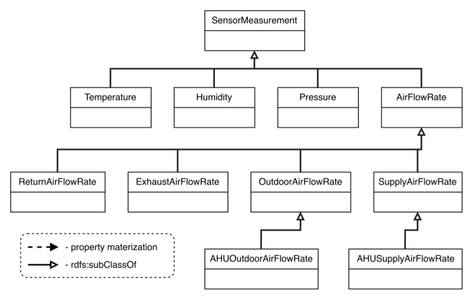
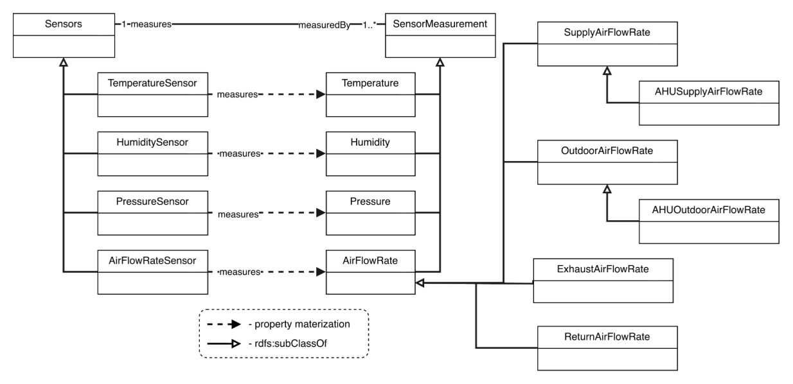
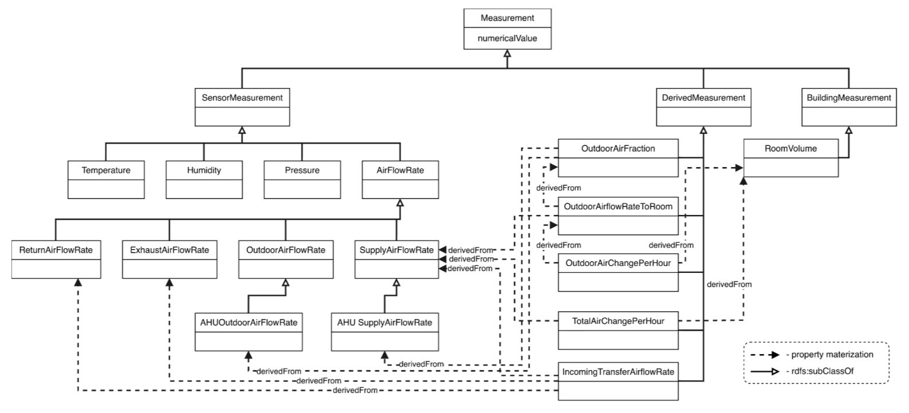
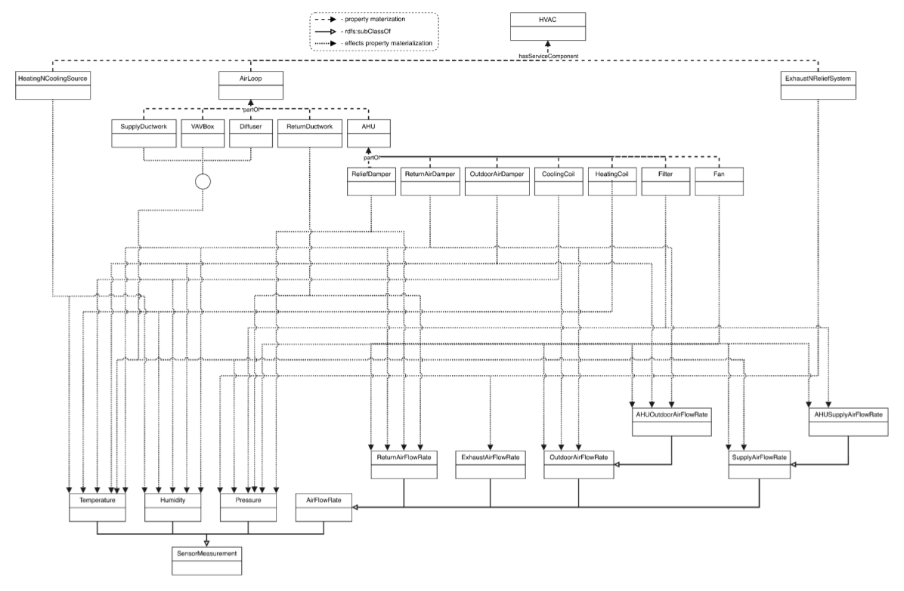
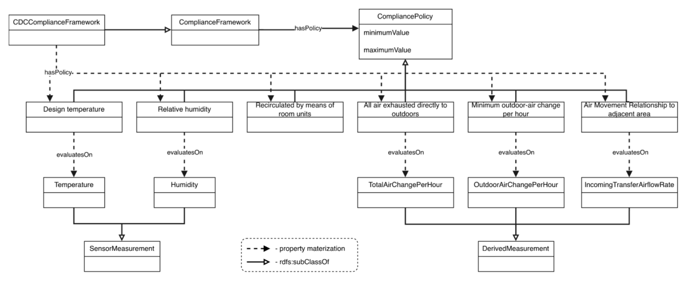

[Conceptual Model](#conceptual-model) | [Design Walkthrough](#design-walkthrough) | [How the Ontology Works](#how-the-ontology-works) | [Ontology Files](#ontology-files) | [Ontologies Reused](#ontologies-reused) | [Ontology Prefixes](#ontology-prefixes)

## Overview

The CareAir ventilation-compliance ontology joins three bodies of knowledge that normally live in three unconnected places: the **clinical space program** (which rooms exist and what they are used for), the **mechanical model** (which HVAC systems and components serve which rooms) and the **building management system** (what the sensors have measured). Once they are in one graph, a question such as *"did ICU-01 meet the CDC ventilation standard at 14:30, and if not, which equipment is involved?"* is asked once and answered by inference, with the evidence attached.

| | |
|---|---|
| **Ontology IRI** | `https://tw.rpi.edu/ontology-engineering/oe2026/ventilation-compliance/ventilation-compliance/` |
| **Default prefix** | `v:` |
| **Language** | OWL 2 DL with SWRL rules (evaluated with Pellet); closed-world checks in SHACL-AF (evaluated with pySHACL) |
| **Imports** | PROV-O (2013-04-30), SAREF4BLDG v2.1.1, RealEstateCore Core v3.3, OMG Commons Quantities and Units |
| **Source files** | [ventilation-compliance.rdf](ventilation-compliance.rdf) (TBox and rules), [individuals.rdf](individuals.rdf) (test ABox, generated by [code/](code/README.md)), [catalog-v001.xml](catalog-v001.xml) (Protégé import catalog) |
| **Creators** | Ahosan Habib, Nipun Deelaka, Andy Cheng, Carina Liu |

The design follows the requirements of the [use case](usecase) (R1 to R9). Three of them shape almost every modelling decision:

- **R3 – derive, do not assert, which system serves which room.** The relation between an air handling unit and a room is a consequence of the ductwork, so it is inferred from components and their connections.
- **R5 / R6 – evaluate by inference and keep the provenance.** Policies are data with bounds and units, not code. Every determination links the measurement it used, the time it was taken and the policy it was compared against.
- **R7 / R8 – report candidates, never a confirmed cause, and stay read-only.** The ontology attaches HVAC components and systems to a failed assessment as *associated with* it, not as its cause, and it never writes to the building.

## Conceptual Model

<a href="././files/images/conceptual/01-core-conceptual-diagram.png" target="_blank">
  
</a>

*Core conceptual diagram (version 9). The full slide deck, with one slide per module and figure descriptions in the speaker notes, is linked from the [About page](index#list-of-resources).*

The diagram uses colour to separate three kinds of data, because they arrive at different times and are stored in different places (see the [system architecture](index#system-architecture)):

| Colour | Meaning | Examples |
|---|---|---|
| **Blue** classes and arrows | *Static* data about one building: its rooms, its service systems and components, the compliance frameworks that apply to it | `Building`, `Room`, `HVACSystem`, `BuildingServiceComponent`, `ComplianceFramework`, `CompliancePolicy`, `hasServiceComponent`, `connectsTo`, `hasPolicy` |
| **Green** arrows | *Static* relations that cross module boundaries and are meant to be reused across buildings | `isPartOf`, `measures`, `evaluatesOn`, `actsOn` / `isAffectedBy` |
| **Purple** classes and arrows | *Dynamic* data created by measuring and assessing, published as nanopublications in the proposed architecture | `Measurement`, `SensorMeasurement`, `DerivedMeasurement`, `AssessmentContext`, `usesMeasurement`, `forRoom` |
| **Yellow** classes and arrows | *Inferred* data, worked out by the reasoner and never typed in by hand | `ComplianceAssessment` status classes, `PolicyAssessment` status classes, `servesRoom`, `wasAssociatedWithComponent`, `wasAssociatedWithSystem` |

The core diagram was designed around four behaviours observed in the use case, and the walkthrough below follows them in the same order:

1. How **rooms** connect to **building service components**, and how that connection decides which **building service system serves which room**.
2. How **sensor measurements** taken at a time are tied to the **room** the sensor is in, and how **derived measurements** are computed from them.
3. How **compliance policies** are grouped in **compliance frameworks** and declare which **measurement** each policy checks.
4. How a **compliance assessment** of a room at a time is built from **policy assessments**, and how a failed assessment is traced back to the **system and components** involved.

## Design Walkthrough

Each step below takes one region of the conceptual diagram, shows the detailed slide for that module, and explains what was modelled, which vocabulary it was reused from, and why.

### Step 1 – Buildings and rooms

The starting point is the spatial context. A `core:Building` (from RealEstateCore) `hasRoom` zero or more `core:Room`s, and `hasBuildingSystem` zero or more `BuildingSystem`s. `hasRoom` is declared a sub-property of `cmns-col:hasPart`, so a room is formally a part of its building. Rooms are related to each other by `neighbor`, a symmetric property that the measurement module uses later (Step 3).

<a href="./files/images/conceptual/02-room-taxonomy.png" target="_blank">
  
</a>

*Healthcare facility (room) taxonomy.*

The room taxonomy is taken directly from the space list in the CDC *Guidelines for Environmental Infection Control in Health-Care Facilities*, Appendix B (Air), because that is the list the compliance policies are written against. Six top-level areas sit under `core:Room`:

| Top-level area | Example subclasses in the ontology |
|---|---|
| `CriticalCareArea` | `ICU`, `OperatingRoom`, `RecoveryRoom`, `TraumaRoom`, `DelieveryRoom`, `BronchoscopyRoom`, `EndoscopyRoom`, `TreatmentRoom` |
| `NursingArea` | `PatientRoom`, `AirborneInfectionIsolationRoom`, `ProtectiveEnvironmentRoom`, `IsolationAlcove`, `LaborRoom`, `NewbornNurserySuite`, `PatientCorridor`, `ToiletRoom` |
| `DiagnosticAndTreatmentArea` | `ExaminationRoom`, `MedicationRoom`, `PhysicalTherapyRoom`, `HydrotherapyRoom`, `SoiledWorkroom`, `SterilizingAndSupplyArea`, `ETOSterilizerRoom`, `SterilizerEquipmentRoom` |
| `LaboratoryArea` | `GeneralLab`, `MicrobiologyLab`, `PathologyLab`, `AutopsyRoom`, `Pharmacy`, `NonrefrigeratedBodyHoldingRoom`, and other laboratory types |
| `RadiologyArea` | `XRayRoom`, `DarkRoom` |
| `CentralMedicalAndSurgicalSupplyArea` | `DecontaminationRoom`, `CleanWorkroom`, `SterileStorage`, `ServiceArea`, `GeneralLaundry`, `SoiledLinenStorage`, `CleanLinenStorage`, `BedpanRoom`, `Bathroom`, `JanitorsCloset`, and others |

Every room class carries an `rdfs:label` and a `skos:definition`. The test individuals use a single class, `ICU`, for the three rooms ICU-01 (room 4E-12), ICU-02 and ICU-03.

> **Design note.** The use case (requirement R1) asks for clinical function to be a time-bounded *role* of a space rather than a permanent subclass, because hospital rooms are re-designated. The current release types rooms directly (`ICU_01 a v:ICU`) for simplicity; the role-based representation is a planned extension and would not change the policy or assessment modules.

### Step 2 – Building service systems, components and the *serves* relation

<a href="./files/images/conceptual/03-hvac-component-taxonomy.png" target="_blank">
  
</a>

*HVAC component taxonomy and part-of structure.*

The mechanical side of the model has two classes and three relations.

- `BuildingServiceSystem` (a sub-class of `fso:System` from the Flow Systems Ontology) is a system that supplies, distributes or controls a utility or environmental service. `HVACSystem` is its only specialisation so far.
- `BuildingServiceComponent` (a sub-class of `fso:Component`) is anything that is part of such a system and contributes to delivery, distribution, control or measurement. Its taxonomy, shown above, groups HVAC equipment under four sub-assemblies: `HeatingAndCoolingSource` (boiler, chiller, heat pump, direct-expansion unit), `AirLoop` (air handling unit, supply and return ductwork, VAV box, diffuser), `ExhaustAndReliefSystem` (exhaust inlet, exhaust ductwork, exhaust fan, outdoor discharge) and `Controls` (sensors, controllers, actuators). The AHU in turn has its own parts: fan, filter, heating coil, cooling coil and the outdoor-air, return-air and relief dampers. Equipment classes that already exist in SAREF4BLDG (`Boiler`, `Chiller`, `Fan`, `Sensor`, `Controller`, `Actuator`) are reused rather than redefined.
- `hasServiceComponent` links a system to its components. It is declared a sub-property of **both** `fso:hasComponent` and `cmns-col:hasPart`. Part-of nesting *inside* a component (a filter inside an AHU) uses `cmns-col:isPartOf`, which is transitive and the inverse of `cmns-col:hasPart`. Because of this, a filter asserted only as part of AHU-3 is also inferred to be a part of HVAC-3.
- `connectsTo` is the topological link from a component to the room it discharges into or draws from. A `BuildingServiceComponent` connects to at most one room (`connectsTo max 1 core:Room`).

The relation the use case cares about, **`servesRoom`**, is never asserted. It is defined as a property chain:

```
hasServiceComponent ∘ connectsTo ⊑ servesRoom
```

so if HVAC-3 has the service component VAV-412 and VAV-412 connects to room 4E-12, the reasoner concludes that HVAC-3 serves 4E-12. `servesRoom` is a sub-property of `core:serves` from RealEstateCore, so any tool that understands RealEstateCore also understands the inferred relation. Nested parts are deliberately *not* used by the chain: a damper inside an AHU is a part of the system but does not by itself make the system serve a room.

Supporting axioms on `BuildingServiceComponent`: it may only be part of another component or of a service system (`isPartOf only (BuildingServiceComponent or BuildingServiceSystem)`), and every component acts on at least one sensor measurement (Step 5).

### Step 3 – Sensors and sensor measurements

<a href="./files/images/conceptual/04-sensor-measurement-taxonomy.png" target="_blank">
  
</a>

*Sensor measurement taxonomy.*

`Measurement` is the root of all observed and computed values. It is a sub-class of `prov:Entity` and must carry exactly one `prov:generatedAtTime` (`xsd:dateTime`), which is how the model records *when* a value was taken. It has three sub-classes:

- `SensorMeasurement` – a value read directly from a sensor. It carries exactly one `cmns-qtu:hasQuantityValue` pointing to a `cmns-qtu:ScalarQuantityValue`, which in turn carries a `hasNumericValue` and exactly one `hasMeasurementUnit`. Keeping value and unit together on a separate node is what makes unit-aware comparison possible in Step 7.
- `DerivedMeasurement` – a value calculated from other measurements (Step 4).
- `BuildingMeasurement` – a static property of the building such as `RoomVolume`, needed to turn an airflow into an air-change rate.

The sensor measurement taxonomy covers the quantities the CDC policies need: `Temperature`, `Humidity`, `Pressure` and `AirFlowRate`, the last specialised into `SupplyAirFlowRate`, `ReturnAirFlowRate`, `ExhaustAirFlowRate` and `OutdoorAirFlowRate`, with AHU-level variants `AHUSupplyAirFlowRate` and `AHUOutdoorAirFlowRate`.

<a href="./files/images/conceptual/05-sensor-to-measurement.png" target="_blank">
  
</a>

*Sensors to sensor measurement relation materialisation.*

Sensors are `BuildingServiceComponent`s that live under `Controls` and are typed with the SAREF4BLDG class `saref4bldg:Sensor`. Four sub-classes (`TemperatureSensor`, `HumiditySensor`, `PressureSensor`, `AirFlowRateSensor`) are each restricted to `measures some` the matching measurement class, so the kind of sensor fixes the kind of reading. `measures` has the inverse `measuredBy`, and every sensor `measures min 1 SensorMeasurement`.

A measurement is tied to a room in two layers:

- `measuredIn` (domain `SensorMeasurement`) says the measured condition pertains to that room.
- `recordedIn` (domain `Measurement`) is the more general "this record is about this room". `measuredIn` is a sub-property of `recordedIn`, so a query for everything recorded in a room also returns everything measured in it.
- `recordedInNeighbor` is a property chain `recordedIn ∘ neighbor`, which lets a policy about air movement *relative to an adjacent area* find the readings of the neighbouring room.

### Step 4 – Derived measurements and provenance

<a href="./files/images/conceptual/06-derived-measurements.png" target="_blank">
  
</a>

*Derived measurement taxonomy and property materialisation.*

The CDC thresholds are expressed in quantities no sensor reports directly, such as *outdoor air changes per hour*. The ontology therefore models the calculation chain explicitly as `DerivedMeasurement`s linked by `prov:wasDerivedFrom`:

| Derived measurement | Derived from |
|---|---|
| `OutdoorAirFraction` | `AHUOutdoorAirFlowRate`, `AHUSupplyAirFlowRate` |
| `OutdoorAirFlowRateToRoom` | `SupplyAirFlowRate`, `OutdoorAirFraction`, `RoomVolume` |
| `OutdoorAirChangePerHour` | `OutdoorAirFlowRateToRoom` |
| `TotalAirChangePerHour` | `SupplyAirFlowRate`, `RoomVolume` |
| `IncomingTransferAirflowRate` | `ReturnAirFlowRate`, `ExhaustAirFlowRate` |

Each class carries both an existential restriction (`wasDerivedFrom some X`) naming its inputs and a universal one (`wasDerivedFrom only Measurement`) so that derivations can only point at measurements.

`prov:wasDerivedFrom` is intentionally *not* transitive in PROV-O. To let a rule walk a derivation chain of any depth, the ontology introduces the helper property `isTransitivelyDerivedFrom`, declared transitive, with `prov:wasDerivedFrom` as a sub-property. Nothing asserts the helper directly; the reasoner fills it in. This is what allows Step 8 to blame a component that acts on the *supply* airflow for a failure measured in *outdoor air changes per hour*, three derivations later.

### Step 5 – How HVAC components affect measurements

<a href="./files/images/conceptual/07-component-effect-on-measurements.png" target="_blank">
  
</a>

*HVAC component effect on measurements.*

To explain a failure the model has to know which equipment can influence which quantity. This is expressed with `cmns-pas:actsOn` (inverse `cmns-pas:isAffectedBy`) from the OMG Commons Parties and Situations ontology. Every `BuildingServiceComponent` `actsOn some SensorMeasurement`, and each concrete component class narrows that to the measurement kinds it can physically influence, for example:

| Component | acts on |
|---|---|
| `Fan` | supply, return and outdoor airflow rates, AHU airflow rates, pressure |
| `Filter` | supply airflow rate, AHU supply airflow rate, pressure |
| `OutdoorAirDamper` | outdoor airflow rates, return airflow rate, temperature, humidity |
| `HeatingCoil`, `CoolingCoil`, `Boiler`, `Chiller`, `HeatPump`, `DirectExpansionUnit` | temperature, humidity |
| `VariableAirVolumeBox`, `Diffuser`, `SupplyDuctwork` | supply airflow rate, pressure, temperature |
| `ExhaustFan`, `ExhaustInlet`, `ExhaustDuctwork`, `OutdoorDischarge` | exhaust airflow rate, pressure |

At the instance level the building model asserts `actsOn` from each installed component to the specific measurement individuals it influences (in the test data, VAV-412, DF-412, SD-3 and FL-3 each act on the supply airflow reading M-0411). These class-level restrictions document the intended coverage and keep the instance assertions consistent.

### Step 6 – Compliance frameworks and policies

<a href="./files/images/conceptual/08-cdc-compliance-policy-taxonomy.png" target="_blank">
  
</a>

*CDC compliance and policy taxonomy.*

Requirements are **data, not code** (requirement R2). A `ComplianceFramework` `hasPolicy` one or more `CompliancePolicy`s and `appliesToRoom` the rooms it governs. `CDCComplianceFramework` is the framework modelled so far; it is restricted to have one policy of each of the seven kinds that correspond to the columns of the CDC Appendix B table:

| Policy class | evaluates on |
|---|---|
| `MinimumAirChangesOfOutdoorAirPerHour` | `OutdoorAirChangePerHour` |
| `MinimumTotalAirChangesPerHour` | `TotalAirChangePerHour` |
| `AllAirExhaustedDirectlyToOutdoors` | `TotalAirChangePerHour` |
| `AirMovementRelationshipToAdjacentArea` | `IncomingTransferAirflowRate` |
| `RelativeHumidity` | `Humidity` |
| `DesignTemperature` | `Temperature` |
| `RecirculatedByMeansOfRoomUnits` | (permission flag; no measurement) |

The seven policy classes are pairwise disjoint. `evaluatesOn` (inverse `isEvaluatedBy`) is the link from a *kind* of policy to the *kind* of measurement that is evidence for it.

Independently of its subject, every policy is also classified by the **shape of its bound**, again in three disjoint classes:

- `MinBoundedCompliancePolicy` – exactly one `cmns-qtu:hasLowerBound`
- `MaxBoundedCompliancePolicy` – exactly one `cmns-qtu:hasUpperBound`
- `RangeBoundedCompliancePolicy` – exactly one lower and exactly one upper bound

Bounds are `cmns-qtu:ScalarQuantityValue`s with a numeric value and a unit, exactly like measurements. The two classifications are orthogonal on purpose: the ICU policy `P_ACH_min` is both a `MinimumAirChangesOfOutdoorAirPerHour` and a `MinBoundedCompliancePolicy` (lower bound 2.0 air changes per hour), and `P_RH` is both a `RelativeHumidity` policy and a `RangeBoundedCompliancePolicy` (30 to 60 percent relative humidity). The same `RelativeHumidity` class is a `MaxBoundedCompliancePolicy` for the isolation and protective-environment rooms (at most 60 percent), and the `AirMovementRelationshipToAdjacentArea` class is min-bounded for an "In" room and max-bounded for an "Out" room. The SWRL rules in Step 7 key only on the bound shape, so a new CDC policy, or a policy from a different framework such as ASHRAE 170, needs **no new rule**.

Requirement R2 asks for requirements to be data attached to a clinical designation. The test data therefore holds one framework individual per designation (ICU, operating room, airborne infection isolation room, protective environment room, patient room), each an instance of `CDCComplianceFramework`, each with its own policy individuals and bounds, and each applied to its rooms with `appliesToRoom`.

### Step 7 – Assessments: context, policy assessments and compliance assessments

This is the yellow region at the top right of the core diagram. It follows the NIST OSCAL assessment model: an assessment has a scope, evaluates individual controls, and aggregates their findings.

- `Assessment` is the abstract root ("evidence evaluated against criteria to determine an outcome").
- `AssessmentContext` fixes *what* is being assessed and *under which rules*: `forRoom` (the room), `usesFramework` (the compliance framework) and `usesMeasurement` (the measurements logged for this test). Both `uses*` properties specialise `cmns-cxtdsg:uses`.
- `ComplianceAssessment` is the room-level verdict. It `hasContext` an assessment context and `hasPolicyAssessment` one policy assessment per policy that was tested. `evaluatedCompliance` can additionally point straight at the framework.
- `PolicyAssessment` is the unit of evaluation: it `evaluatedPolicy` one `CompliancePolicy`, and the measurement compared against it is linked by `isEvaluatedAt` (inverse `evaluatesMeasurement`). The context may also be linked to the policy assessment with `appliesToPolicyAssessment`.

Status is modelled as **class membership**, not as a status attribute, so that it can be inferred:

| Policy assessment status | Meaning |
|---|---|
| `SatisfiedPolicyAssessment` | the usable evidence meets every requirement of the policy |
| `UnsatisfiedPolicyAssessment` | the usable evidence fails at least one requirement |
| `UnknownPolicyAssessment` | the available information is insufficient to decide |

| Compliance assessment status | OWL definition |
|---|---|
| `SatisfiedComplianceAssessment` | `ComplianceAssessment and (hasPolicyAssessment some PolicyAssessment) and (hasPolicyAssessment only SatisfiedPolicyAssessment)` |
| `UnsatisfiedComplianceAssessment` | `... and (hasPolicyAssessment only UnsatisfiedPolicyAssessment)` |
| `PartiallySatisfiedComplianceAssessment` | `ComplianceAssessment and (hasPolicyAssessment some SatisfiedPolicyAssessment) and (hasPolicyAssessment some UnsatisfiedPolicyAssessment)` |
| `UnknownComplianceAssessment` | `ComplianceAssessment and (hasPolicyAssessment some UnknownPolicyAssessment)` |

Because OWL is open-world, an `only` restriction can be concluded only when the reasoner knows the list of policy assessments is complete. Each `ComplianceAssessment` individual therefore carries a **closure axiom** of the form `hasPolicyAssessment only {PA_ICU_01_ACH, PA_ICU_01_RH}`.

The "unknown" classes exist so that *absence of evidence is never treated as compliance* (post-condition Q3 of the use case). Unknown takes precedence: a single unknown policy assessment makes the whole compliance assessment unknown, which is why its definition uses `some` while the other three use `only`. OWL itself cannot conclude that a policy assessment *has no* evidence, so `UnknownPolicyAssessment` is asserted by a closed-world SHACL step before the reasoner runs (see Layer 2b below).

### Step 8 – Associating failures with systems and components

The final yellow arrows, `wasAssociatedWithComponent` and `wasAssociatedWithSystem`, are sub-properties of `prov:wasAssociatedWith`. They connect an `Assessment` to the `BuildingServiceComponent`s and `BuildingServiceSystem`s linked to its evidence. The wording is deliberate: a component is *associated with* a failed assessment because it acts on the failing measurement or on something that measurement was derived from. The ontology never states that the component *caused* the failure (requirement R7), and the system does not actuate anything (R8). `wasAssociatedWithComponentIndirectly` is reserved for components reached only through a part-of chain.

### Mapping the diagram to the OWL file

The conceptual diagram uses a few short-hand names that were replaced by reused vocabulary when the ontology was encoded:

| On the diagram | In the ontology |
|---|---|
| `Measurement.numericalValue` | `cmns-qtu:hasQuantityValue` → `ScalarQuantityValue` with `hasNumericValue` and `hasMeasurementUnit` |
| `CompliancePolicy.minimumValue` / `maximumValue` | `cmns-qtu:hasLowerBound` / `cmns-qtu:hasUpperBound` → `ScalarQuantityValue` |
| `AssessmentContext.atTime` | `prov:generatedAtTime` on each measurement the context uses |
| `effects` / `isEffectedBy` | `cmns-pas:actsOn` / `cmns-pas:isAffectedBy` |
| `derivedFrom` | `prov:wasDerivedFrom` (plus the transitive helper `isTransitivelyDerivedFrom`) |
| `isPartOf+` | `cmns-col:isPartOf` (transitive), `cmns-col:hasPart` (transitive, inverse) |
| `connectedTo` | `connectsTo` |
| `hasComplianceAssessment` (Room → ComplianceAssessment) | reached through `hasContext` ∘ `forRoom`; not a separate property |
| `Sensors` | `saref4bldg:Sensor` |

## How the Ontology Works

The ontology is meant to answer the competency questions on the [demo page](demo) by inference. Reasoning happens in three layers, from cheapest to most expressive.

### Layer 1 – OWL axioms (structure)

These need only a DL reasoner and no rules:

| Inference | Axiom |
|---|---|
| Which system serves a room | property chain `hasServiceComponent ∘ connectsTo ⊑ servesRoom` |
| A nested part belongs to the system | `hasServiceComponent ⊑ cmns-col:hasPart`, `hasPart` transitive and inverse of `isPartOf` |
| Everything measured in a room is recorded in it | `measuredIn ⊑ recordedIn` |
| Readings of the room next door | property chain `recordedIn ∘ neighbor ⊑ recordedInNeighbor` |
| Full derivation history of a measurement | `prov:wasDerivedFrom ⊑ isTransitivelyDerivedFrom`, the latter transitive |
| Room-level verdict from policy-level verdicts | the four `ComplianceAssessment` definitions plus per-individual closure axioms |

### Layer 2 – SWRL rules (numeric comparison)

OWL cannot compare the numeric values of two different individuals, so the comparison of a measurement with a policy bound is done by SWRL rules S1 to S7, evaluated by Pellet. All seven share the same shape; the min-bounded "unsatisfied" rule is:

```
PolicyAssessment(?a) ^ evaluatedPolicy(?a, ?p) ^ MinBoundedCompliancePolicy(?p)
  ^ cmns-qtu:hasLowerBound(?p, ?lb) ^ cmns-qtu:hasNumericValue(?lb, ?lv) ^ cmns-qtu:hasMeasurementUnit(?lb, ?u)
  ^ isEvaluatedAt(?m, ?a) ^ cmns-qtu:hasQuantityValue(?m, ?q)
  ^ cmns-qtu:hasNumericValue(?q, ?v) ^ cmns-qtu:hasMeasurementUnit(?q, ?u)
  ^ swrlb:lessThan(?v, ?lv)
  -> UnsatisfiedPolicyAssessment(?a)
```

| Rule | Title | Bound shape | Condition | Conclusion |
|---|---|---|---|---|
| S1 | Min bound met | min | value ≥ lower bound | `SatisfiedPolicyAssessment` |
| S2 | Min bound violated | min | value < lower bound | `UnsatisfiedPolicyAssessment` |
| S3 | Max bound met | max | value ≤ upper bound | `SatisfiedPolicyAssessment` |
| S4 | Max bound exceeded | max | value > upper bound | `UnsatisfiedPolicyAssessment` |
| S5 | Within range | range | lower ≤ value ≤ upper | `SatisfiedPolicyAssessment` |
| S6 | Below range | range | value < lower bound | `UnsatisfiedPolicyAssessment` |
| S7 | Above range | range | value > upper bound | `UnsatisfiedPolicyAssessment` |

Note the single variable `?u` bound to the unit of **both** the bound and the measurement. A reading in cubic metres per hour can never be compared with a bound in air changes per hour; the rule simply does not fire, and the policy assessment stays unclassified rather than being wrongly satisfied.

Rules S8 to S11 then attach equipment to a failed assessment:

| Rule | Title | What it does |
|---|---|---|
| S8 | Direct component association | a component that `actsOn` the measurement a policy assessment evaluates → `wasAssociatedWithComponent` |
| S9 | Upstream component association | a component that `actsOn` any measurement the evaluated measurement `isTransitivelyDerivedFrom` → `wasAssociatedWithComponent` |
| S10 | System association | any `BuildingServiceSystem` that `hasPart` (directly or nested) an associated component → `wasAssociatedWithSystem` |
| S11 | Compliance-level component lift | lift `wasAssociatedWithComponent` from the policy assessment up to its `ComplianceAssessment` |

### Layer 2b – closed-world SHACL rules (missing evidence)

Rules S1 to S7 can only fire when a measurement exists. When a sensor did not answer, nothing is asserted, and under the open-world assumption the reasoner cannot tell "no reading" from "reading not yet stated". The project therefore runs two SHACL-AF rules with pySHACL over the data before it is opened in Protégé ([code/shacl/unknown-policy-assessment.ttl](code/shacl/unknown-policy-assessment.ttl)):

| Rule | Condition (closed world) | Conclusion |
|---|---|---|
| U1 | a `PolicyAssessment` with no `isEvaluatedAt` measurement | `rdf:type UnknownPolicyAssessment` |
| U2 | a `ComplianceAssessment` with an unknown policy assessment | `rdf:type UnknownComplianceAssessment` (mirrors the OWL definition for tools without a DL reasoner) |

The same shapes file validates the data: a missing reading is reported as a warning, a satisfied verdict on a room with a missing reading is a violation (Q3), and every measurement must carry exactly one time, a value and a unit. The inferred types are written into the individuals file, so Pellet sees them as ordinary assertions.

### Layer 3 – the intended operational flow

In the proposed system (see the [architecture and activity diagrams](index#system-architecture)) the building graph and the policy graph are static named graphs, each sensor reading is published as a nanopublication with its time and source, and each assessment is published as its own nanopublication linking the readings and policies it used. The ontology above is the schema for all three graphs. The current release demonstrates the reasoning in Protégé over a single test ABox; the nanopublication store and query service are future work.

### Worked example (test of 9 October 2026)

The test individuals describe three ICU rooms, each with an outdoor-air-change reading and a relative-humidity reading, two HVAC systems and the CDC framework with its two encoded policies.

1. **Policy level.** For ICU-01, the outdoor air change rate M-0412 is 1.4 ACH against a lower bound of 2.0 ACH, so S2 fires and `PA_ICU_01_ACH` becomes an `UnsatisfiedPolicyAssessment`. Relative humidity is 45 %RH inside 30 to 60 %RH, so S5 makes `PA_ICU_01_RH` a `SatisfiedPolicyAssessment`. ICU-02 (2.6 ACH, 40 %RH) and ICU-03 (3.1 ACH, 50 %RH) satisfy both.
2. **Room level.** With its closure axiom, `A_ICU_01` has one satisfied and one unsatisfied policy assessment and is classified as a `PartiallySatisfiedComplianceAssessment`; `A_ICU_02` and `A_ICU_03` are `SatisfiedComplianceAssessment`s.
3. **Which system.** HVAC-3 `hasServiceComponent` VAV-412, which `connectsTo` ICU-01, so the chain infers `HVAC-3 servesRoom ICU-01`. HVAC-4 serves only ICU-02 and ICU-03.
4. **Which components.** M-0412 was derived from the outdoor air flow rate to the room M-0413, which was derived from the supply air flow rate M-0411. VAV-412, DF-412, SD-3 and FL-3 all `actsOn` M-0411, so S9 associates all four with the failed policy assessment. AHU-3 is correctly absent: it is part of HVAC-3 but acts on nothing in the failing chain.
5. **Which system is implicated.** FL-3 is asserted only as part of AHU-3, but `hasPart` is transitive, so S10 lifts the association to HVAC-3 without any hard-coded reference to it.

The regenerated test data adds four more rooms of different types, each tested at 08:00, 14:30 and 20:00 on the same day, with full derivation chains from the supply, return, exhaust and air-handler readings. Three cases are worth tracing on the [demo page](demo):

- **OR-01 at 14:30**: the operating-room temperature of 24.1 °C exceeds the 20 to 23 °C design range (range-bounded, rule S7), and the coils and terminal units that act on temperature are associated with the failure.
- **PE-01 at 08:00**: the humidity sensor did not answer, so no measurement exists; SHACL rule U1 marks the humidity policy assessment unknown and the room's assessment becomes `UnknownComplianceAssessment` although its other four policies are satisfied.
- **AII-01, PE-01 and PR-01 at 20:00**: all three fall below their minimum outdoor air changes at once. Each room's outdoor air change rate was derived from its supply airflow and the outdoor air fraction of the shared air handler AHU-6, whose outdoor-air damper OAD-6 is partly closed. Through the derivation closure and rule S9, OAD-6 (together with the fan, filter, duct and each room's terminal units) is associated with all three failures, and rule S10 lifts the association to HVAC-6, with nothing in the data naming the damper as a cause.

The queries that retrieve each of these results, with their expected rows, are on the [Demonstration and Queries](demo) page.

### Known limitations and open points

- **Unknown status needs the SHACL step.** `UnknownPolicyAssessment` cannot be derived by OWL, because "no measurement was logged" is an absence. It is materialised by the pySHACL rules in [code/](code/README.md) before the file is opened in Protégé; data produced without that step would leave such policy assessments unclassified rather than unknown.
- **Mixed states.** With the revised definition, unknown takes precedence: an assessment with unsatisfied *and* unknown policy assessments is both `UnknownComplianceAssessment` and, if it also has a satisfied one, `PartiallySatisfiedComplianceAssessment`. Queries that report failures should treat the unknown class as "not verified" rather than as a failure.
- **Reasoner.** The SWRL built-ins `swrlb:lessThan` and `swrlb:greaterThanOrEqual` are accepted by Pellet but rejected by HermiT, so the rules and the classification above require Pellet.
- **Unit conversion** is not performed; measurement and bound must already share a unit.
- **Clinical designation as a role** (R1), a staleness window on measurements, and other frameworks such as ASHRAE 170 are deferred extensions and fit the existing policy and assessment pattern without new rules.

## Ontology Files

| File | Contents |
|---|---|
| [ventilation-compliance.rdf](ventilation-compliance.rdf) | the ontology (TBox): classes, properties, restrictions, units, and SWRL rules S1 to S11 |
| [individuals.rdf](individuals.rdf) | test ABox `…/test-individuals/`: the hand-authored ICU scenario (three ICU rooms, HVAC-3 and HVAC-4, one test) plus the generated scenario (operating room, airborne infection isolation room, protective environment room, patient room and a corridor; HVAC-5 and HVAC-6; CDC policies per room type; readings at three test times; derived measurements with provenance; 15 compliance assessments). Imports the ontology. |
| [code/](code/README.md) | the Python pipeline that generates the individuals file: scenario, building model, derived-measurement calculations, assessment builder, pySHACL closed-world check, and a reference check that prints the expected competency-question answers |
| [code/shacl/unknown-policy-assessment.ttl](code/shacl/unknown-policy-assessment.ttl) | SHACL-AF rules U1 and U2 and the data-quality shapes |
| [catalog-v001.xml](catalog-v001.xml) | Protégé XML catalog that resolves the four imports to local copies in `files/imports/` (prov-o.rdf, saref4bldg.rdf, core.rdf, qun.rdf) |
| [OE 9 Team HVCC SPARQL Queries.txt](OE%209%20Team%20HVCC%20SPARQL%20Queries.txt) | the competency-question queries and how to run them |

To explore the ontology, open `individuals.rdf` in Protégé with the catalog in the same folder, start the **Pellet** reasoner, and use the Snap SPARQL Query tab (or the built-in SPARQL Query tab for queries that use `prov:generatedAtTime`). To change the test data, edit `code/careair/scenario.py` and run `python code/run_pipeline.py`; the pipeline keeps the hand-authored ICU individuals and regenerates the rest.

## Ontologies Reused

The reused vocabularies are grouped by the module they support. Full citations are on the [Related Work](related_work) page and in the references sheet of the [terminology list](termlist).

### Imported

- [RealEstateCore Core 3.3](https://doc.realestatecore.io/3.3/core.html) (`core:`) – `Building`, `Room`, `serves`, `componentOf`. Supplies the spatial classes and the super-property of `servesRoom`.
- [SAREF4BLDG 2.1.1](https://saref.etsi.org/saref4bldg/v2.1.1/) (`saref4bldg:`) – `Sensor`, `Boiler`, `Chiller`, `Fan`, `Controller`, `Actuator` and the SAREF core `Actuator`. Supplies equipment and sensor classes.
- [W3C PROV-O](https://www.w3.org/TR/prov-o/) (`prov:`) – `Entity`, `generatedAtTime`, `wasDerivedFrom`, `wasAssociatedWith`, `wasInfluencedBy`. Supplies measurement time, derivation and the association of assessments with equipment.
- [OMG Commons Quantities and Units](https://www.omg.org/spec/Commons/QuantitiesAndUnits/) (`cmns-qtu:`) – `ScalarQuantityValue`, `MeasurementUnit`, `hasQuantityValue`, `hasNumericValue`, `hasMeasurementUnit`, `hasLowerBound`, `hasUpperBound`. Supplies values with units for both measurements and policy bounds.

### Referenced without import

- [OMG Commons Collections](https://www.omg.org/spec/Commons/Collections/) (`cmns-col:`) – transitive `hasPart` / `isPartOf`.
- [OMG Commons Parties and Situations](https://www.omg.org/spec/Commons/PartiesAndSituations/) (`cmns-pas:`) – `actsOn` / `isAffectedBy`.
- [OMG Commons Contextual Designators](https://www.omg.org/spec/Commons/ContextualDesignators/) (`cmns-cxtdsg:`) – `uses` / `isUsedBy`.
- [Flow Systems Ontology (FSO)](https://alikucukavci.github.io/FSO/) (`fso:`) – `System`, `Component`, `hasComponent`.
- [SWRL](https://www.w3.org/submissions/SWRL/) and the SWRL built-ins (`swrl:`, `swrlb:`) – rule syntax and comparison built-ins.
- [SKOS](http://www.w3.org/2004/02/skos/core#) – `definition`, `altLabel`, `note` annotations on every term.

### Reviewed as sources of terms and definitions

- [ASHRAE Standard 223P](https://open223.info/) – building topology and observable properties; the current ontology does not import it but keeps its connection-point view of systems in mind.
- [Brick Schema 1.4](https://ontology.brickschema.org/1.4/) – sensor point and equipment typing.
- [W3C SSN / SOSA](https://www.w3.org/TR/vocab-ssn/) – observation and feature-of-interest pattern behind `measures` and `recordedIn`.
- [QUDT](http://qudt.org/) – units reference; OMG Commons was chosen instead for its lighter footprint.
- [NIST OSCAL assessment layer](https://pages.nist.gov/OSCAL/) – source of the assessment, context and policy-assessment decomposition.
- [ODRL formal semantics](https://w3c.github.io/odrl/formal-semantics/) and [W3C EARL 1.0](https://www.w3.org/TR/EARL10-Schema/) – policy and evaluation-result vocabulary.
- [ASHRAE Terminology](https://terminology.ashrae.org/), [ASHRAE 170 Table 7.1](https://icpsne.org/Ventilation%20Appendix%20Table%207.1%20Design%20Parameters.pdf), [CDC Infection Control: Air](https://www.cdc.gov/infection-control/hcp/environmental-control/air.html), [VIM (JCGM 200:2012)](https://www.bipm.org/documents/20126/2071204/JCGM_200_2012.pdf), [ISO/IEC 17000:2020](https://www.iso.org/standard/73029.html) and [ISO 704:2022](https://www.iso.org/standard/79077.html) – definitions of HVAC, measurement and conformity-assessment terms, written following ISO 704.

## Ontology Prefixes

<table style="width:100%">
  <tr>
    <th>Prefix</th>
    <th>Namespace</th>
  </tr>
  <tr>
    <td>v</td>
    <td><a href="ventilation-compliance.rdf">https://tw.rpi.edu/ontology-engineering/oe2026/ventilation-compliance/ventilation-compliance/</a> (CareAir ventilation-compliance ontology)</td>
  </tr>
  <tr>
    <td>test</td>
    <td><a href="individuals.rdf">https://tw.rpi.edu/ontology-engineering/oe2026/ventilation-compliance/test-individuals/</a> (test individuals)</td>
  </tr>
  <tr>
    <td>rdf</td>
    <td><a href="http://www.w3.org/1999/02/22-rdf-syntax-ns#">http://www.w3.org/1999/02/22-rdf-syntax-ns#</a></td>
  </tr>
  <tr>
    <td>rdfs</td>
    <td><a href="http://www.w3.org/2000/01/rdf-schema#">http://www.w3.org/2000/01/rdf-schema#</a></td>
  </tr>
  <tr>
    <td>owl</td>
    <td><a href="http://www.w3.org/2002/07/owl#">http://www.w3.org/2002/07/owl#</a></td>
  </tr>
  <tr>
    <td>xsd</td>
    <td><a href="http://www.w3.org/2001/XMLSchema#">http://www.w3.org/2001/XMLSchema#</a></td>
  </tr>
  <tr>
    <td>skos</td>
    <td><a href="http://www.w3.org/2004/02/skos/core#">http://www.w3.org/2004/02/skos/core#</a></td>
  </tr>
  <tr>
    <td>dc / dcterms</td>
    <td><a href="http://purl.org/dc/elements/1.1/">http://purl.org/dc/elements/1.1/</a>, <a href="http://purl.org/dc/terms/">http://purl.org/dc/terms/</a></td>
  </tr>
  <tr>
    <td>prov</td>
    <td><a href="http://www.w3.org/ns/prov#">http://www.w3.org/ns/prov#</a> (W3C PROV Ontology)</td>
  </tr>
  <tr>
    <td>core</td>
    <td><a href="https://w3id.org/rec/core/">https://w3id.org/rec/core/</a> (RealEstateCore Core)</td>
  </tr>
  <tr>
    <td>saref4bldg</td>
    <td><a href="https://saref.etsi.org/saref4bldg/">https://saref.etsi.org/saref4bldg/</a> (SAREF extension for buildings)</td>
  </tr>
  <tr>
    <td>saref</td>
    <td><a href="https://saref.etsi.org/core/">https://saref.etsi.org/core/</a> (SAREF core)</td>
  </tr>
  <tr>
    <td>fso</td>
    <td><a href="https://w3id.org/fso#">https://w3id.org/fso#</a> (Flow Systems Ontology)</td>
  </tr>
  <tr>
    <td>cmns-qtu</td>
    <td><a href="https://www.omg.org/spec/Commons/QuantitiesAndUnits/">https://www.omg.org/spec/Commons/QuantitiesAndUnits/</a></td>
  </tr>
  <tr>
    <td>cmns-col</td>
    <td><a href="https://www.omg.org/spec/Commons/Collections/">https://www.omg.org/spec/Commons/Collections/</a></td>
  </tr>
  <tr>
    <td>cmns-pas</td>
    <td><a href="https://www.omg.org/spec/Commons/PartiesAndSituations/">https://www.omg.org/spec/Commons/PartiesAndSituations/</a></td>
  </tr>
  <tr>
    <td>cmns-cxtdsg</td>
    <td><a href="https://www.omg.org/spec/Commons/ContextualDesignators/">https://www.omg.org/spec/Commons/ContextualDesignators/</a></td>
  </tr>
  <tr>
    <td>swrl / swrlb</td>
    <td><a href="http://www.w3.org/2003/11/swrl#">http://www.w3.org/2003/11/swrl#</a>, <a href="http://www.w3.org/2003/11/swrlb#">http://www.w3.org/2003/11/swrlb#</a></td>
  </tr>
  <tr>
    <td>swrla</td>
    <td><a href="http://swrl.stanford.edu/ontologies/3.3/swrla.owl#">http://swrl.stanford.edu/ontologies/3.3/swrla.owl#</a> (rule enable/disable annotation)</td>
  </tr>
  <tr>
    <td>sh</td>
    <td><a href="http://www.w3.org/ns/shacl#">http://www.w3.org/ns/shacl#</a> (closed-world rules and shapes in code/shacl/)</td>
  </tr>
</table>
